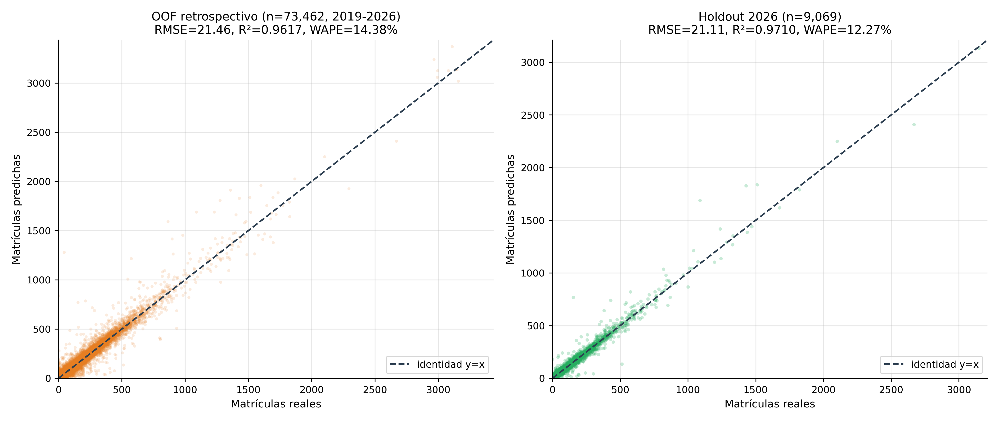
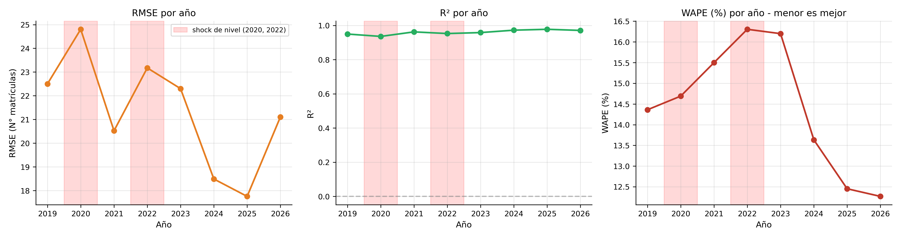
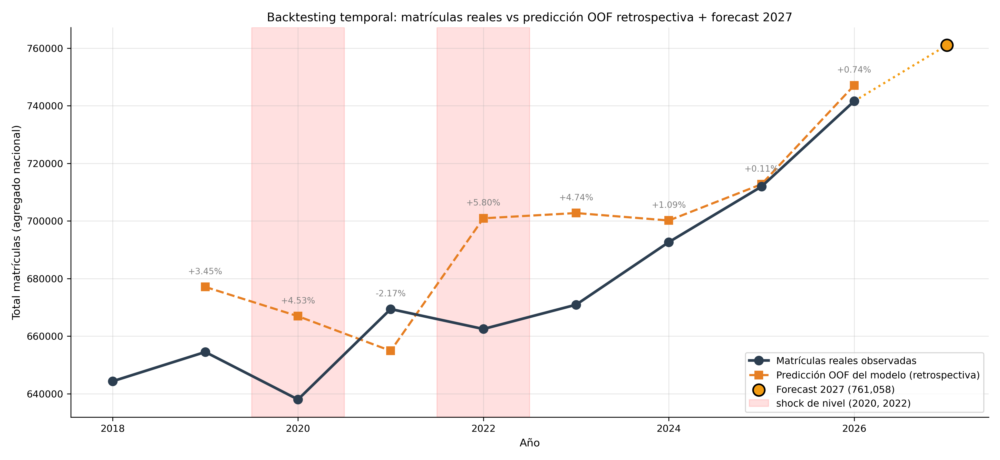
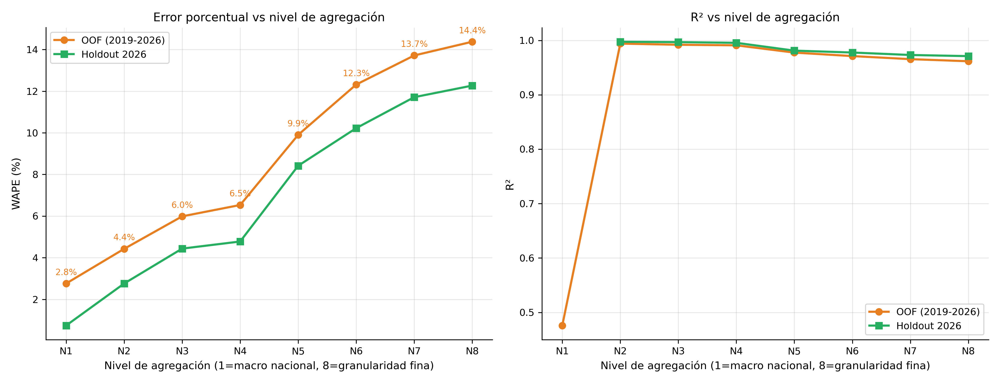
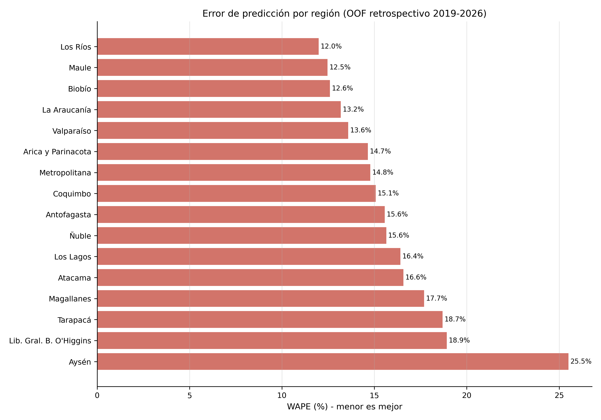
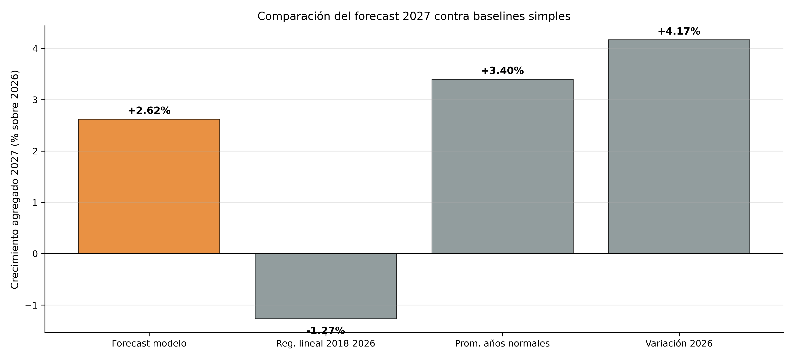

# Predicción de la dinámica de matrícula universitaria en Chile mediante machine learning: validación out-of-time, intervalos conformes y una advertencia sobre el baseline

**Autor:** Diego Evans Pérez Paz

**Fecha:** Agosto de 2026 · revisado en septiembre de 2026 · actualizado en noviembre de 2026

**Versión:** pipeline v4 · modelo vigente `modelo_final_20261118_1345` (CatBoost, entrenamiento cerrado
en 2026, pronóstico 2027) · modelo validado contra el dato real 2026: `modelo_final_20260813_1535`
(entrenamiento cerrado en 2025)

> **Actualización de noviembre de 2026: re-estimación con datos hasta 2026 y pronóstico 2027.** Con
> la matrícula 2026 del SIES (edición del 10 de julio de 2026) y la base INDICES del CNED de agosto de
> 2026, el pipeline v4 se volvió a ejecutar **sin cambios de método**: sólo se desplazó un año la
> ventana. El modelo nuevo se entrena con 2018-2025, se evalúa a ciegas sobre 2026 y pronostica 2027.
> Las cifras de las secciones 3, 4 y 5.2-5.3 y 5.6-5.8 corresponden ahora a esa corrida. La validación
> *out-of-time* de la sección 5.4 se conserva tal cual: mide el modelo anterior, entrenado hasta 2025,
> contra el dato real 2026, y sigue siendo la evidencia principal del trabajo. El pronóstico 2027
> (sección 5.9) se publica antes de que el SIES publique la matrícula 2027 y queda **pre-registrado**:
> será la primera prueba limpia del pipeline corregido. El código fuente dejó de publicarse en este
> repositorio; el método completo está descrito en el documento técnico funcional
> (`Documents/DOCUMENTO_TECNICO_FUNCIONAL.md`).
>
> **Corrección del 20 de noviembre de 2026: evaluación contra la matrícula observada.** El panel
> guarda la tasa de crecimiento recortada a sus percentiles 1 y 99 para entrenar, y la matrícula
> «real» de la evaluación se reconstruía desde esa tasa recortada (1.430 filas de 2018-2026, 75 del
> holdout). Las métricas del holdout 2026, del OOF y del holdout 2025 de v4 (Tablas 3, 4 y 10), la
> cobertura de las bandas y las figuras se recalcularon contra la matrícula observada del SIES, sin
> reentrenar. La validación *out-of-time* de la sección 5.4 no cambia: ya usaba el dato del SIES. El
> pronóstico 2027 (761.058) tampoco cambia; su crecimiento se expresa sobre la base observada
> (+2,62 % sobre 741.615; antes, +2,80 % sobre 740.318).
>
> **Nota de versión (agosto de 2026).** Esta versión reemplaza a la de junio de 2026 (`paper_modelo_matricula_chile_v3_FINAL.md`,
> disponible en el historial de este repositorio). Entre ambas ocurrieron dos
> cosas: se publicó la matrícula real 2026 del SIES, permitiendo una validación *out-of-time*
> genuina; y la auditoría del pipeline motivada por esa validación reveló dos defectos en la llave
> del lag que corrompían simultáneamente el target de entrenamiento y el baseline de persistencia.
> **Todas las cifras de la sección 5 cambiaron.** El registro de qué cambió y por qué está en la
> sección 5.1; el diagnóstico completo, en el documento técnico funcional, §6
> (`Documents/DOCUMENTO_TECNICO_FUNCIONAL.md`).
>
> **Revisión de septiembre de 2026.** El modelo y sus cifras no cambian. Se precisó el orden de los
> hechos —el pronóstico congelado antes de la publicación del SIES fue el de junio; el de v4 se generó
> en agosto, sin datos de 2026—, se agregó el desempeño por institución (sección 5.4, Tabla 6), se
> documentaron los años de calibración de los intervalos y se corrigieron el conteo de instituciones
> del forecast y el enlace al repositorio. La revisión del código para la documentación técnica agregó
> tres precisiones: tres variables usan la matrícula del año evaluado (sección 6.5), el codificador del
> modelo usa ponderación sigmoide y no el estimador $m$ (secciones 4.6 y 5.6), y CatBoost quedó tercero
> en el tuning (sección 4.8).
>
> En este texto, «v4» sin más designa al modelo entrenado hasta 2025; el modelo entrenado hasta 2026
> se designa «corrida 2027».

---

## Resumen

La predicción de matrícula universitaria es un insumo crítico para la planificación institucional y
la política pública. La mayoría de los estudios disponibles en América Latina trabaja con datos
agregados a nivel nacional, valida con particiones aleatorias que filtran información del futuro, y
—cuando reporta comparaciones contra un baseline— no publica el desempeño de ese baseline al lado
del propio. Este trabajo propone un marco replicable de *machine learning* para pronóstico de
matrícula de pregrado universitario a granularidad fina (institución × carrera × región × jornada ×
género × condición × año), integrando diez fuentes oficiales chilenas. Sobre un dataset consolidado
de 82.967 observaciones (2018-2026) se aplica validación temporal estricta —*expanding window* de
siete *folds*, holdout ciego 2026— y *target encoding* calculado dentro de cada *fold*. El modelo
seleccionado (CatBoost, optimizado con Optuna) alcanza en el holdout 2026 un WAPE de 12,27 % frente
al 13,09 % del baseline de persistencia, un R² de 0,9710 frente a 0,9666, y un *skill score* de
+13,21 %. Pronostica para 2027 **761.058 matrículas** sobre el universo modelado, un crecimiento de
**+2,62 %** sobre la matrícula observada de 2026; el pronóstico se publica antes del dato oficial y queda pre-registrado.

La contribución central no es ese número sino la verificación del pipeline contra un dato que ninguna
etapa de entrenamiento ni de *tuning* vio: la matrícula real 2026 publicada por el SIES. Un pronóstico
congelado en junio de 2026, antes de esa publicación, destapó un defecto en la llave del lag;
corregido y reestimado con la ventana cerrada en 2025, el modelo obtiene sobre las 8.729 celdas
emparejadas WAPE 11,49 % contra 12,69 % del naïve, *skill score* **+26,71 % positivo en los ocho
niveles de agregación**, y un error agregado de −0,01 %. El crecimiento predicho (+2,26 %) coincide
con el observado (+2,27 %). Se añaden intervalos de predicción por *conformal prediction*
estratificada, con cobertura empírica de 92,5 % contra un objetivo de 90 %.

Metodológicamente el trabajo aporta tres resultados. **(i)** Un defecto en la llave del lag afecta al
modelo y a su baseline *simultáneamente*, porque el naïve **es** el lag; el *skill score* resultante
se sesga en dirección impredecible —en este caso lo infló en 2025 y lo hundió en 2026— y el error es
invisible para cualquier diagnóstico que sólo mire las métricas del modelo. **(ii)** Un *target
encoding* precalculado sobre todo el dataset infla el desempeño aparente en 3,2 % del RMSE frente a
uno *fold-aware* (3,5 % en v4), una cifra que mezcla la fuga con un cambio en la fórmula de
suavizado. **(iii)** El R² sobre niveles absolutos es una métrica engañosa en este dominio: la
persistencia sola alcanza 0,9666 en el holdout 2026, de modo que ningún R² debería citarse sin el de
su baseline al lado.

**Palabras clave:** matrícula universitaria, pronóstico, *gradient boosting*, validación temporal,
validación *out-of-time*, *conformal prediction*, *skill score*, *target encoding*, sistema
universitario chileno.

---

## 1. Introducción

La planificación de la educación superior demanda proyecciones de matrícula a múltiples niveles de
agregación. A nivel macro, la autoridad requiere proyecciones nacionales para anticipar demanda de
gratuidad y crédito, y para dimensionar la oferta de cupos. A nivel meso, las universidades necesitan
proyecciones por carrera y campus para asignar presupuesto docente, dimensionar infraestructura y
anticipar necesidades de retención. A nivel micro, los equipos de admisión y dirección académica
requieren información granular para decidir aperturas de cohorte, cierres de programa y campañas de
captación.

Predecir matrícula universitaria es difícil por tres razones estructurales. **Primero**, el sistema
chileno integra señales de fuentes heterogéneas que rara vez se modelan conjuntamente: estadísticas
del Servicio de Información de Educación Superior (SIES) del MINEDUC, indicadores institucionales del
Consejo Nacional de Educación (CNED), variables socioeconómicas regionales del Instituto Nacional de
Estadísticas (INE) y del Banco Central, y métricas de empleabilidad de mifuturo.cl. **Segundo**, la
matrícula presenta heterogeneidad estructural en varias dimensiones simultáneas —institución,
carrera, región, jornada, género y condición de alumno nuevo o antiguo—: los modelos agregados
pierden esa heterogeneidad y los modelos finos enfrentan ruido idiosincrático elevado. **Tercero**, el
período 2020-2022 introdujo una anomalía estructural sin precedentes.

A esas tres dificultades este trabajo agrega una cuarta, que resultó ser la más consecuente:
**la matrícula es tan inercial que el baseline correcto es muy difícil de batir, y por lo tanto muy
fácil de medir mal**. Un programa de cinco años arrastra cuatro cohortes ya matriculadas. La
persistencia —predecir que el año próximo será igual al anterior— alcanza por sí sola un R² de entre
0,969 y 0,974 sobre matrículas absolutas en los dos últimos años observados. Cualquier modelo alcanzará un R² alto; la pregunta relevante es si supera
esa referencia, y responderla exige que la referencia esté bien construida.

### 1.1 Contribuciones

**C1. Un marco replicable de integración de diez fuentes oficiales chilenas** a granularidad séxtuple
más año, produciendo un dataset consolidado de 82.967 observaciones para 2018-2026, con la llave de
lag documentada y auditada, y re-ejecutable cada año a medida que las fuentes publican.

**C2. Una validación *out-of-time* con su estatus declarado.** El pronóstico 2026 se contrastó
contra la publicación oficial del SIES, un dato que ninguna etapa de entrenamiento ni de *tuning* vio.
Esto es infrecuente en la literatura aplicada de pronóstico educativo, donde predomina la validación
retrospectiva. El modelo obtiene *skill score* positivo en los ocho niveles de agregación y un error
agregado de −0,01 %. Se declara qué se congeló antes de la publicación y qué se reestimó después
(sección 5.1). Para cerrar esa salvedad, el pronóstico 2027 del pipeline corregido se publica antes
del dato oficial (sección 5.9).

**C3. Una advertencia metodológica sobre el baseline: el naïve *es* el lag.** Cuando el baseline de
persistencia se construye a partir de la misma columna de lag que alimenta al modelo, un defecto en
la llave de esa columna contamina numerador y denominador del *skill score* a la vez. El sesgo
resultante no tiene dirección predecible: en este trabajo el mismo defecto infló el skill de 2025
hasta +77,4 % y lo hundió a −8,0 % en 2026. Ningún diagnóstico centrado en las métricas del modelo lo
habría detectado. Se documenta el defecto, su detección y su corrección.

**C4. Intervalos de predicción con cobertura verificada.** Se aplica *conformal prediction* dividida y
estratificada por tamaño de celda, calibrada sobre los residuos retrospectivos. La cobertura empírica
es 91,5 % en el holdout y 92,5 % en la validación *out-of-time*, contra un objetivo nominal de 90 %.

**C5. Cuantificación empírica del sesgo de *target encoding* mal aplicado**: precalcularlo sobre todo
el dataset infla el desempeño aparente en 3,2 % del RMSE de validación cruzada (3,5 % en v4). La comparación también
cambia la fórmula de suavizado, así que la cifra no aísla sólo la fuga (sección 5.6).

El resto del trabajo se organiza así: la sección 2 revisa el estado del arte; la sección 3 describe
los datos; la sección 4 detalla la metodología, incluyendo la construcción de la llave de lag; la
sección 5 presenta los resultados, empezando por el registro de la corrección; la sección 6 discute
hallazgos y limitaciones; la sección 7 concluye.

---

## 2. Estado del arte

Esta sección se apoya en un levantamiento de publicaciones oficiales, literatura académica y oferta
comercial hecho en agosto de 2026. Se hizo en buscador general y no en bases académicas indexadas (SciELO, Scopus, WoS), de modo que no debe leerse como una revisión
sistemática.

### 2.1 Lo que publica el Estado chileno: descriptivo, no predictivo

El **SIES** publica anualmente el *Informe de Matrícula en Educación Superior*. La edición 2026
reporta 1.497.548 matrículas totales, 1.372.167 de pregrado y 759.045 en universidades. Las tres
cifras coinciden exactamente con las calculadas de forma independiente en este trabajo a partir del
CSV crudo, lo que constituye una validación cruzada del pipeline de ingesta.

El **CNED**, a través del sistema INDICES, entrega series 2005-2026 de matrícula total y de primer
año, número de programas, aranceles, acreditación y gratuidad, desagregables por tipo de institución,
región y área del conocimiento. Publica además proyecciones de **población** de 18 a 24 años hasta
2030.

La distinción importa. Ambos organismos publican el pasado con granularidad excelente, y el CNED
proyecta el *pool* demográfico de postulantes. Ninguno publica un pronóstico de **matrícula** para el
año siguiente, ni a nivel de sistema ni de programa. La proyección demográfica responde «cuántos
jóvenes habrá»; no responde «cuántos se matricularán en esta carrera de esta universidad».

### 2.2 La literatura chilena de ML en educación superior: otro nivel de análisis

La producción académica chilena que aplica aprendizaje automático a educación superior está
concentrada en **predicción a nivel de estudiante individual**: deserción y retención —incluyendo
trabajo financiado por FONDEF sobre tecnologías de datos masivos para retención y éxito estudiantil—,
casos institucionales de facultad, y minería de datos con algoritmos de clasificación.

Todos responden a la pregunta *«¿este estudiante desertará?»*. Ninguno a *«¿cuántos habrá matriculados
en este programa el año que viene?»*. Son problemas distintos: el primero es clasificación a nivel de
persona con datos internos de una institución; el segundo es regresión sobre celdas agregadas con
datos públicos de todo el sistema. Esa diferencia de nivel de análisis, y no una diferencia de
sofisticación técnica, es lo que separa este trabajo de la literatura nacional existente.

### 2.3 La oferta comercial: enrollment management, no forecasting de sistema

El mercado internacional de analítica predictiva para educación superior está dominado por
proveedores estadounidenses —Ruffalo Noel Levitz, EAB, Rapid Insight, Capture Higher Ed, Othot
(Liaison), Civitas Learning (Ellucian)— que comparten tres rasgos: operan a nivel de **postulante o
estudiante individual**, trabajan con **datos internos** del cliente (CRM de admisión, notas,
interacciones), y su pregunta es *«¿qué postulantes debo perseguir y con qué mensaje?»*.

La pregunta de este trabajo es distinta: *«¿cómo se moverá la matrícula del sistema y dónde queda esta
institución dentro de ese movimiento?»*. No son productos competidores sino complementarios: uno
optimiza la captación de una institución, el otro dimensiona el mercado en que esa captación ocurre.

En Chile no se identificó ningún producto vertical de pronóstico de matrícula. El ecosistema se
compone de consultoras de inteligencia de negocios genérica, formación de posgrado en *analytics*, y
equipos internos de análisis institucional. Lo que existe es capacidad genérica de BI aplicada caso a
caso, que produce tableros del pasado, no pronósticos validados.

Existe además literatura crítica sobre el uso de algoritmos de matrícula en educación superior, que
advierte que optimizar la captación puede agravar problemas de equidad. Es material pertinente para
la sección 6.5: posiciona esta herramienta como instrumento de **planificación**, no de **selección**.

### 2.4 Métodos: gradient boosting, validación temporal y predicción conforme

Entre los métodos de aprendizaje automático sobre datos tabulares, los algoritmos de *gradient
boosting* —LightGBM [@ke2017lightgbm], XGBoost [@chen2016xgboost] y CatBoost [@prokhorenkova2018catboost]—
mantienen el estado del arte frente a arquitecturas profundas en problemas estructurados de
cardinalidad moderada [@shwartz2022tabular]. Su robustez ante multicolinealidad, su captura de
no-linealidades e interacciones, y su tolerancia a valores faltantes los hacen adecuados para este
problema.

Sobre validación, la literatura de pronóstico advierte hace décadas que las particiones aleatorias
sobre series temporales producen estimaciones optimistas, y recomienda evaluación *out-of-sample*
con origen móvil [@tashman2000; @bergmeir2012]. La discusión sobre *leakage* en minería de datos está
formalizada en @kaufman2012, que define la fuga como la introducción en el conjunto de entrenamiento
de información no disponible legítimamente en el momento de la predicción.

El *target encoding* —reemplazar una categoría por la media condicional del target
[@micci2001target]— es un caso particularmente frecuente de fuga cuando se precalcula fuera del
*fold*.

Para la cuantificación de incertidumbre este trabajo usa *conformal prediction* [@vovk2005], en su
variante dividida o inductiva [@papadopoulos2002; @lei2018], que produce intervalos con garantía de
cobertura marginal en muestra finita sin supuestos sobre la distribución del error. La estratificación
por grupos —conocida como conformal de Mondrian— es la respuesta estándar a la heterocedasticidad
[@vovk2005; @angelopoulos2023].

Para la evaluación se emplean el *skill score* respecto de un baseline de referencia, práctica
estándar en meteorología operacional [@murphy1988], y el MASE [@hyndman2006], que normaliza el error
absoluto por el del pronóstico ingenuo.

### 2.5 El vacío

Chile tiene datos públicos de matrícula de calidad excepcional —granularidad de programa, veinte años
de serie— y no se está usando de forma sistemática y validada para pronosticar. Ese es el vacío en el
que se sitúa este trabajo.

---

## 3. Datos

### 3.1 Fuentes integradas

Se integraron diez fuentes oficiales del ecosistema chileno de educación superior (Tabla 1).

**Tabla 1.** Fuentes de datos integradas

| Fuente | Organismo | Variables aportadas | Período |
|---|---|---|---|
| Base de matrículas SIES | MINEDUC | Matrícula por institución × carrera × jornada × género × condición × año (tabla principal) | 2007-2026 |
| BaseINDICES CNED | CNED | Aranceles, vacantes, puntajes de admisión, duración de carreras | 2005-2026 (2026 parcial) |
| Cuerpo Docente CNED | CNED | Docentes por grado académico y jornada | 2018-2025 |
| Inmuebles e infraestructura CNED | CNED | M² construidos, salas, oficinas por sede | 2018-2025 |
| PIB regional | Banco Central | PIB regional anual a precios corrientes | 2018-2025 (2026 arrastrado) |
| Tasa de desocupación regional | INE (SIMEL) | Desempleo anual por región y sexo | 2018-2025 (2026 arrastrado) |
| Empleabilidad e ingresos | mifuturo.cl | Retención de primer año, empleabilidad por carrera-institución | 2018-2025 |
| Diccionario sede-región | CNED | Mapeo de códigos de sede a códigos INE (380 sedes) | Estático |
| Diccionario de instituciones | SIES | Catálogo canónico de 220 instituciones | Estático |
| Diccionario de carreras | SIES | Catálogo canónico de 15.940 nombres de carrera | Estático |

### 3.2 Procedimiento ETL

El pipeline comprende cinco fases: (i) **auditoría de compatibilidad** entre fuentes para identificar
formatos, codificaciones (UTF-8-SIG con BOM, separadores `;` y `,`) y granularidades; (ii)
**normalización de llaves** mediante diccionarios canónicos de regiones, instituciones y carreras;
(iii) **merge secuencial** sobre año + región y, cuando aplica, año + institución + carrera; (iv)
**imputación jerárquica** (sección 3.4); (v) **ingeniería de variables**.

El dataset final contiene **82.967 observaciones** a granularidad institución × carrera × región ×
jornada × género × condición × año para 2018-2026, con 52 columnas de las que 49 entran al modelo. El
año 2018 se usa exclusivamente como base de lag y no recibe predicciones. El universo comprende 62
instituciones universitarias, 1.432 nombres de carrera canónicos, 16 regiones y 10 áreas del
conocimiento; el forecast 2027 cubre 9.069 celdas de 53 instituciones con programas vigentes en 2026.
El modelo v4, entrenado hasta 2025, usaba 73.896 observaciones y 1.373 nombres de carrera, y su
forecast 2026 cubría 55 instituciones, 53 de ellas presentes en el dato real 2026.

**Supuestos de la corrida 2027.** Cuando una fuente todavía no publica el año más reciente, el
pipeline arrastra su último valor y lo registra: el PIB regional y la desocupación de 2026 repiten
los de 2025; la planta docente y la infraestructura toman el último año disponible; la retención y la
empleabilidad, la mediana histórica del programa. La base INDICES del CNED cubre 2026 sólo en parte.
La edición 2026 del SIES revisa además la matrícula 2025 en +53 estudiantes respecto de la edición
anterior.

### 3.3 Variable de interés

La variable a predecir es la **tasa de crecimiento de matrícula**:

$$ \text{tasa}_t = \frac{\text{matrículas}_t - \text{matrículas}_{t-1}}{\text{matrículas}_{t-1}} $$

Se aplica una transformación arcsinh —simétrica, que comprime las colas y preserva el signo:

$$ \text{target}_t = \operatorname{arcsinh}(\text{tasa}_t) = \ln\left(\text{tasa}_t + \sqrt{\text{tasa}_t^2 + 1}\right) $$

Las predicciones se revierten con el seno hiperbólico y se reconstruye el nivel absoluto:

$$ \widehat{\text{matrículas}}_t = \text{matrículas}_{t-1} \times \left(1 + \sinh(\hat{\text{target}}_t)\right) $$

Esta reconstrucción es central para leer los resultados. El modelo se **optimiza** sobre la tasa
—variable de alta varianza y baja predictibilidad— pero se **evalúa** sobre matrículas absolutas
—variable de altísima inercia—, que es la magnitud que importa en planificación. La sección 6.2
discute por qué esa asimetría explica la brecha entre un R² de 0,10 sobre la tasa y uno de 0,98 sobre
el nivel.

Antes del entrenamiento se winsoriza la tasa al 1 % y 99 %.

### 3.4 Imputación jerárquica

Las fuentes tienen distintos grados de completitud, por lo que se imputa por capas que respetan la
lógica de granularidad; cada capa cubre sólo lo que la anterior dejó vacío: (1) temporal, por
interpolación lineal sobre el año con relleno hacia adelante y atrás dentro de institución-región;
(2) jerárquica, de (institución, carrera) hacia (institución, área, año) y luego (área, año);
(2.5) región-carrera; (2.7) institución; (3) terminal, mediana global.

Se genera una bandera binaria `fue_imputado` por fila. **El 70,9 % de las filas contiene al menos una
variable imputada** (67,3 % en v4), concentrado en aranceles y retención; el aumento proviene de 2026,
para el que varias fuentes aún no publican. La sección 6.5 discute la limitación.

---

## 4. Metodología

### 4.1 Diseño general

El pipeline se estructura en seis fases: (i) validación de integridad; (ii) exploración descriptiva
del target; (iii) detección de shocks; (iv) definición de feature sets y preprocesamiento; (v)
evaluación de baselines y candidatos; (vi) tuning del modelo seleccionado. Cada fase deja artefactos
versionados con marca de tiempo.

### 4.2 La llave del lag

Esta subsección describe una decisión de diseño que en versiones anteriores estaba implícita y que
resultó ser la más consecuente del pipeline.

La variable `matriculas_lag1` es la matrícula del año anterior en la misma celda. Construirla exige
emparejar cada celda de un año con su equivalente del año previo, y ese emparejamiento falla cuando
la nomenclatura cambia. El SIES renombra nombres de carrera entre ediciones: un programa que en 2024
se llamaba «PEDAGOGÍA EN EDUCACIÓN BÁSICA» puede aparecer en 2025 como «PEDAGOGÍA EN EDUCACIÓN GENERAL
BÁSICA». Con una llave basada en el nombre literal, la celda pierde su lag y **sale del universo
modelable**.

Se adopta por tanto una llave con tres niveles de respaldo en cascada:

| Nivel | Llave de emparejamiento |
|---|---|
| Fino | institución, nombre de carrera, región, jornada, género, condición |
| Código | institución, código de carrera, región, jornada, género, condición |
| Medio | institución, código de carrera, región |

El nivel fino empareja por nombre literal. El primer respaldo empareja por **código** de carrera, que
el SIES conserva a través de los renombres. El segundo respaldo agrega jornada, género y condición.

**El escalado por participación.** El nivel `MEDIO` agrega tres dimensiones, de modo que su total no
es comparable con una celda individual: usarlo directamente equivale a comparar una parte contra el
todo que la contiene, y produce tasas de crecimiento espurias cercanas a −1. El respaldo se aplica
por tanto escalado por la participación de la celda en su grupo:

$$ \text{lag}_{\text{celda}} = \text{lag}_{\text{grupo}} \times \frac{\text{matrículas}_{\text{celda},t}}{\text{matrículas}_{\text{grupo},t}} $$

Así la celda hereda el *crecimiento* de su grupo en lugar de compararse contra su *nivel*. La regla
general que se desprende: **el numerador y el denominador de una tasa deben compartir la llave**.

Se registra el nivel utilizado en la columna `origen_lag`, lo que permite auditar la composición: de
las 82.967 filas, **81.259 (97,9 %) se emparejan en el nivel fino**, 694 (0,8 %) por código y 1.014
(1,2 %) por el nivel medio escalado. La composición es prácticamente la misma que en v4 (97,9 %,
0,9 % y 1,2 % sobre 73.896 filas): el año agregado no trajo una ola de renombres.

### 4.3 El baseline de persistencia y por qué comparte código con el lag

El baseline naïve predice $\widehat{\text{matrículas}}_t = \text{matrículas}_{t-1}$, es decir, **la
misma columna `matriculas_lag1`** que alimenta al modelo. Esto no es una elección de implementación
sino una identidad: el pronóstico de persistencia y la variable de inercia del modelo son el mismo
objeto.

La consecuencia es que un defecto en la llave del lag no degrada al modelo contra un baseline sano,
sino que degrada **ambos a la vez**, y el *skill score* —un cociente entre los dos— se sesga en una
dirección que depende de cuál de los dos resulte más dañado en cada año. La sección 5.1 documenta el
caso concreto. La implicación práctica se enuncia en la sección 6.3.

### 4.4 Estrategia de validación temporal

La estructura temporal del dataset impide particiones aleatorias. Se adoptan cuatro componentes:

- **Holdout final ciego:** el último año observado —2026 en la corrida 2027, 2025 en v4— se reserva y
  no se usa en ninguna etapa de selección ni tuning.
- **Cross-validation interno:** *expanding window* sobre 2018-2025. El *fold* $k$ entrena con
  $\{2018, \ldots, 2017+k\}$ y valida sobre $2018+k$, para $k = 1, \ldots, 7$. **Son siete *folds***,
  con años de validación 2019 a 2025 (seis en v4, hasta 2024).
- **Predicciones OOF retrospectivas:** para cada año $Y \in \{2019, \ldots, 2026\}$ se entrena un
  modelo independiente con todos los datos previos a $Y$ y se predice $Y$.
- **Validación *out-of-time*:** el forecast se contrasta contra el dato real del SIES, que ninguna
  etapa de entrenamiento ni de *tuning* vio. El de v4 ya se contrastó contra 2026 (sección 5.4); es el
  componente más difícil de sobreajustar —con la salvedad de la sección 5.1: ese dato motivó la
  auditoría que produjo v4— y por eso se trata como el resultado principal. El de la corrida 2027 se
  contrastará contra la publicación de julio de 2027.

Una advertencia sobre el OOF retrospectivo, discutida en 6.5: los hiperparámetros se optimizan una
vez sobre el CV completo y luego se reutilizan para ajustar cada modelo OOF anual, de modo que las
predicciones OOF de años tempranos incorporan hiperparámetros elegidos con información posterior. El
holdout y el forecast no tienen ese problema.

### 4.5 Detección empírica de shocks

Para identificar los años anómalos de forma reproducible se aplican dos criterios sobre la
distribución del target. **Criterio 1:** se calculan la media y la desviación estándar del target por
año, se estandarizan contra los años no candidatos, y se clasifica como *shock de nivel* todo año con
$|Z_{\text{media}}| > 1{,}96$ y como *shock de dispersión* todo año con $|Z_{\text{desv}}| > 1{,}96$.
**Criterio 2:** cualquier año candidato con variación agregada negativa no clasificado por el
criterio 1 se marca como *shock de recaída*.

**Resultado:** tanto en v4 como en la corrida 2027 el procedimiento clasifica **2020 y 2022 como
shock de nivel**, y deja **vacías las categorías de dispersión y recaída**; agregar 2026 no cambia la
clasificación. Se agregan al feature set las tres dummies
correspondientes sin penalización por peso muestral.

Dos observaciones honestas sobre este componente. Primera, versiones anteriores de este trabajo
reportaron una clasificación tripartita —2020 nivel, 2021 dispersión, 2022 recaída— que **la corrida
actual no reproduce**; el cambio en la construcción del lag alteró la distribución del target lo
suficiente como para modificar la clasificación. Segunda, dado que dos de las tres categorías quedan
vacías, `es_shock_dispersion` y `es_shock_recaida` son **columnas constantes en cero** entre las 49
*features*: no aportan información y su presencia es puramente estructural. La sección 6.4 discute
qué queda en pie de esta contribución.

### 4.6 Target encoding fold-aware

Las categóricas de alta cardinalidad —`REGIÓN` (16), `NOMBRE INSTITUCIÓN` (62), `NOMBRE CARRERA`
(1.432) y `area_conocimiento` (10)— se codifican con *target encoding* suavizado. El codificador del
modelo es el `TargetEncoder` de `category_encoders` con `smoothing = 30`, que pondera la media de cada
categoría con una sigmoide de su número de observaciones:

$$ \text{TE}(c) = \bar{y}_{\text{global}}\,(1 - w_c) + \bar{y}_c\, w_c, \qquad w_c = \frac{1}{1 + e^{-(n_c - k)/s}}, \qquad s = 30,\ k = 20 $$

La codificación se implementa **dentro** del pipeline de scikit-learn, de modo que en cada *fold* se
ajusta únicamente con los datos de entrenamiento de ese *fold*. El dataset contiene además columnas
`te_*` precalculadas sobre todo el conjunto con el estimador $m$, $\text{TE}(c) = (n_c \bar{y}_c + m\,
\bar{y}_{\text{global}})/(n_c + m)$ con $m = 30$; están **excluidas explícitamente** del entrenamiento y
existen sólo para el experimento de la sección 5.6.

### 4.7 Feature engineering

Sobre las variables crudas se construyen derivadas en cuatro grupos: **lags temporales**
(`matriculas_lag1`, transformada con log1p); **ratios estructurales** del cuerpo docente
(`pct_doctores`, `pct_magister`, `pct_horas_jornada_completa`); **indicadores competitivos y de
mercado** (`densidad_competitiva`, `arancel_relativo_regional`, `selectividad_relativa`,
`concentracion_matricula_lag`, `pct_matricula_regional_lag`); y las **dummies de shock**. El feature
set final del modelo de árboles contiene **49 variables** (45 numéricas y 4 categóricas con TE).

### 4.8 Modelos evaluados y optimización

Se evalúan cuatro baselines informados —**B0** mediana del entrenamiento, **B1** media histórica por
(institución, carrera), **B2** Ridge sólo con el lag, **B3** Ridge con el feature set reducido— y tres
modelos de *gradient boosting*. A estos se suma el baseline de persistencia de la sección 4.3, que es
el relevante sobre matrículas absolutas.

La optimización usa Optuna [@akiba2019optuna] con *sampler* TPE y `MedianPruner`, 50 *trials* por
modelo, evaluando cada *trial* sobre los siete *folds* y minimizando el RMSE promedio en escala
arcsinh.

**Sobre la elección del modelo final.** Tras el tuning, CatBoost quedó **tercero** por RMSE de CV
en ambas corridas: en la corrida 2027, 0,2949 frente a 0,2933 de XGBoost y 0,2943 de LightGBM (en v4,
0,2986 frente a 0,2974 y 0,2982). Entre el primero y el tercero hay 0,5 %, menos que el sesgo medido
en la sección 5.6. Se fijó como modelo de producción en v4 por una razón de tooling
que descartaba a XGBoost: la versión de `shap` de ese entorno (0.45.1) era incompatible con la
serialización de `base_score` de `xgboost` 3.x, y `TreeExplainer` fallaba sobre ese modelo. La corrida
2027 se ejecutó con `shap` 0.54.1, que sí explica `xgboost` 3.2.0, así que esa razón ya no aplica: en
esta corrida CatBoost se mantiene por continuidad de método. Tampoco hubo nunca una razón para
preferirlo a LightGBM, que `shap` sí podía explicar: la elección mantiene el modelo de las versiones
anteriores y no tiene fundamento de desempeño. Con diferencias de este tamaño, cualquiera de
los tres habría servido. La decisión queda registrada en el pipeline y se mantiene entre corridas para
que el pronóstico 2027 sea el del mismo método validado en 2026.

### 4.9 Métricas

Se reportan, **siempre con el valor del baseline al lado**:

- **RMSE**, **MAE**, **MedAE** en número de matrículas.
- **R²**, con la advertencia de la sección 6.1.
- **WAPE:** $100 \times \sum|y - \hat{y}| / \sum y$; robusta ante ceros y rangos heterogéneos.
- **Sesgo agregado:** $100 \times (\sum \hat{y} - \sum y) / \sum y$; distingue error que se cancela de
  error sistemático.
- **±10 %:** porcentaje de grupos cuya predicción cae dentro del 10 % del valor real. Traduce la
  métrica a una promesa verificable por el usuario.
- **Skill score** [@murphy1988]: $1 - (\text{RMSE}_{\text{modelo}} / \text{RMSE}_{\text{naïve}})^2$.
  Positivo significa que el modelo elimina error del baseline; negativo, que es peor que no hacer nada.
- **MASE** [@hyndman2006]: cociente de MAE contra el del naïve. Menor que 1 es mejor que persistencia.

### 4.10 Intervalos de predicción

Se aplica *conformal prediction* dividida [@papadopoulos2002; @lei2018]. Sea $\{r_i\}$ el conjunto de
residuos de calibración y $\alpha$ el nivel de error deseado; los extremos del intervalo son los
cuantiles empíricos con la corrección de muestra finita

$$ k_{\text{hi}} = \left\lceil (n+1)(1 - \alpha/2) \right\rceil, \qquad k_{\text{lo}} = \left\lfloor (n+1)\,\alpha/2 \right\rfloor $$

sobre los residuos ordenados. Tres decisiones de diseño:

1. **Estratificación por tamaño** (conformal de Mondrian, [@vovk2005]). El error es fuertemente
   heterocedástico: el cuantil superior cae de 0,796 en celdas de 10 a 13 estudiantes a 0,162 en las de
   168 o más. Un intervalo global sería simultáneamente inútil para las celdas grandes y falsamente
   estrecho para las pequeñas.
2. **Calibración en el espacio del target.** Los residuos se calibran sobre $\operatorname{arcsinh}$
   de la tasa y se transforman después con la misma reconstrucción del pipeline, de modo que los
   intervalos hereden la asimetría del espacio original.
3. **Los agregados no se suman.** Sumar los intervalos de las celdas supondría que todas yerran en la
   misma dirección simultáneamente. Cada nivel de agregación se calibra sobre su propio error, medido
   en $\log(\hat{y}/y)$ y estratificado por tamaño de grupo.

La cobertura de la sección 5.5 corresponde a v4 y se mide calibrando con los residuos OOF 2019-2024,
de modo que el holdout 2025 y el dato 2026 quedan fuera de la calibración. Las bandas que se publican
en el tablero se recalibran después incluyendo 2025. Los intervalos del pronóstico 2027 se calibran con
el mismo procedimiento sobre los residuos de la corrida 2027 (sección 5.9).

Se requieren al menos 30 observaciones de calibración por estrato; por debajo de ese umbral no se
emite intervalo conforme. La sección 5.5 documenta el caso del total nacional, donde esa regla se
activa.

---

## 5. Resultados

### 5.1 Registro de la corrección: qué cambió entre v3 y v4

Esta subsección precede a los resultados porque sin ella las cifras no son comparables con las de la
versión anterior de este trabajo.

**Cómo se detectó.** La versión de junio de 2026 congeló un pronóstico 2026 y reportó, sobre el
holdout 2025, un *skill score* de +77,4 %. Cuando el SIES publicó la matrícula real 2026, el mismo
modelo obtuvo un *skill score* de **−8,0 %**: peor que no hacer nada. Un deterioro de esa magnitud
entre dos años consecutivos no es atribuible a deriva del fenómeno, y motivó una auditoría del
pipeline.

**Qué se encontró.** Dos defectos en la llave del lag descrita en la sección 4.2:

1. **Renombres de carrera.** La llave fina emparejaba por nombre literal sin respaldo por código. El
   SIES renombró los 20 programas de una institución en 2025 y el pipeline los descartó: esa
   institución pasó de 3.726 a 351 matrículas modelables.
2. **Mezcla de granularidad en el respaldo.** El nivel `MEDIO` agregaba jornada, género y condición
   sólo en el denominador. Esto generaba 3.763 filas con una razón lag/celda mediana de 8× y una tasa
   mediana de −0,875: contracciones que no eran reales sino artefacto de comparar una celda contra un
   agregado que la contiene.

En conjunto corrompían aproximadamente el **4 % de los targets de entrenamiento** y, por la identidad
de la sección 4.3, **el baseline de persistencia en la misma proporción**.

**Efecto de la corrección.** Tras aplicar el escalado por participación, el nivel `MEDIO` pasó de una
tasa mediana de −0,875 con razón 8,00× a **+0,196 con razón 0,84×**, y los targets artificiales
bajaron de 2.944 a **cero**. La Tabla 2 contrasta las dos versiones.

**Tabla 2.** v3 (junio 2026) frente a v4 (agosto 2026)

| | v3 | v4 |
|---|---:|---:|
| Filas de entrenamiento | 75.622 | **73.896** |
| Skill score, holdout 2025 | +77,39 % | **+22,87 %** |
| **Skill score, out-of-time 2026** | **−8,02 %** | **+26,71 %** |
| Niveles de agregación con skill negativo en 2026 | los cuatro más finos | **ninguno** |
| WAPE 2026, granularidad fina | 12,20 % | **11,49 %** |
| R² 2026 frente a su naïve | 0,9648 < 0,9674 | **0,9760 > 0,9673** |
| Error agregado 2026 | −2,04 % | **−0,01 %** |
| Crecimiento predicho frente al real | +0,23 % vs +2,31 % | **+2,26 % vs +2,27 %** |

**Sobre el estatus epistémico de esta corrección.** Es importante ser preciso. No hubo fuga de datos:
la ventana de entrenamiento sigue cerrada en 2025 y ningún dato de 2026 entra al modelo en ninguna
etapa. Lo que ocurrió es que el dato real 2026 actuó como **señal diagnóstica** que motivó auditar el
pipeline, y la auditoría encontró un defecto que existía desde antes y era independiente de 2026 —de
hecho, verificable enteramente sobre datos de 2018-2025—. Dicho esto, la distinción que corresponde
mantener es que **v3 era un pronóstico pre-registrado y v4 es una reestimación posterior a conocer el
resultado**. Las cifras de v4 sobre 2026 son *out-of-sample* pero no pre-registradas, y deben leerse
con ese matiz. La prueba limpia del pipeline corregido será el dato 2027 (sección 5.9).

### 5.2 Desempeño global

Desde esta subsección y hasta la 5.3, las cifras son las de la corrida 2027: entrenamiento con
2018-2025, holdout ciego 2026. CatBoost alcanza un RMSE de 0,2949 en validación cruzada sobre el
target en escala arcsinh (0,2986 en v4). Los hiperparámetros seleccionados son 2.000 iteraciones, tasa
de aprendizaje 0,0376, profundidad 7, regularización L2 de 1,75, temperatura de *bagging* 0,546 y 183
*border counts*.

Sobre matrículas absolutas, la Tabla 3 resume el desempeño en los dos conjuntos retrospectivos, con
el baseline de persistencia al lado de cada métrica y la fila equivalente de v4 como referencia.

**Tabla 3.** Desempeño global sobre matrículas absolutas

| Conjunto | n | R² | R² naïve | WAPE | WAPE naïve | Skill | MASE | Sesgo |
|---|---:|---:|---:|---:|---:|---:|---:|---:|
| OOF retrospectivo 2019-2026 | 73.462 | 0,9617 | 0,9616 | 14,38 % | 14,88 % | **+0,09 %** | 0,9662 | +2,23 % |
| **Holdout 2026 (ciego)** | 9.069 | **0,9710** | 0,9666 | **12,27 %** | 13,09 % | **+13,21 %** | 0,9372 | +0,74 % |
| *v4: holdout 2025 (ciego)* | *9.041* | *0,9782* | *0,9717* | *12,35 %* | *13,23 %* | *+22,87 %* | *0,9333* | *−0,29 %* |

Todas las métricas se calculan contra la matrícula observada del SIES (corrección del 20-11-2026: antes se usaba la matrícula reconstruida desde la tasa recortada del panel; ver la nota de versión).

Tres lecturas. Primera, **los dos R² están pegados**: 0,9617 contra 0,9616 en el OOF. El R² alto no
lo produce el modelo, lo produce la inercia de la matrícula. Reportarlo sin su naïve al lado sería
engañoso, y es la razón por la que la sección 6.1 recomienda no citarlo aislado.

Segunda, **el skill del OOF completo es prácticamente nulo (+0,09 %)**, muy por debajo del holdout.
La causa está en la sección 5.3: los años tempranos se predicen con muy pocos datos de entrenamiento y
arrastran el promedio.

Tercera, **el holdout 2026 es más difícil que el de 2025**. El modelo le gana a la persistencia en
WAPE (12,27 % contra 13,09 %) y en MASE (0,937), pero su *skill* baja de +22,87 % a +13,21 % y su
sesgo agregado pasa de −0,29 % a +0,74 %. Dos hechos concurren. La persistencia mejoró: su WAPE bajó
de 13,23 % a 13,09 %, de modo que hay menos error que eliminar. Y el error cuadrático se concentra en
pocas instituciones grandes cuyo total el modelo sobreestimó entre 4 % y 10 %; como el *skill* se mide
sobre el error cuadrático, esas pocas celdas grandes pesan más que la mejora repartida en el resto.

**Dos cifras de 2026 que no deben confundirse.** El holdout de la corrida 2027 (*skill* +13,21 % sobre
9.069 celdas) y la validación *out-of-time* de v4 (*skill* +26,71 % sobre 8.729 celdas, sección 5.4)
miden el mismo año con instrumentos distintos. El holdout usa las exógenas observadas de 2026 y la
edición 2026 del SIES, incluye las celdas nuevas que ya tienen lag y sale de un modelo entrenado con
hiperparámetros elegidos sobre siete *folds*; la validación de v4 congela las exógenas en 2025 y
empareja contra la edición 2026 sólo las celdas que existían en 2025. Ninguna de las dos es una
versión corregida de la otra.

### 5.3 Desempeño por año

Cada año $Y$ del OOF se predice entrenando exclusivamente con los años anteriores, de modo que el
volumen de entrenamiento crece monótonamente. La Tabla 4 documenta el patrón.

**Tabla 4.** Desempeño anual (OOF retrospectivo, corrida 2027)

| Año | n | R² | WAPE | Skill | Real | Predicho | Sesgo |
|---:|---:|---:|---:|---:|---:|---:|---:|
| 2019 | 9.424 | 0,950 | 14,36 % | **−34,89 %** | 654.495 | 677.096 | +3,45 % |
| 2020 | 9.321 | 0,936 | 14,69 % | **−13,71 %** | 637.998 | 666.925 | +4,53 % |
| 2021 | 9.230 | 0,962 | 15,50 % | +19,99 % | 669.403 | 654.899 | −2,17 % |
| 2022 | 9.161 | 0,953 | 16,31 % | **−2,98 %** | 662.479 | 700.931 | +5,80 % |
| 2023 | 9.038 | 0,958 | 16,20 % | **−8,97 %** | 670.918 | 702.750 | +4,74 % |
| 2024 | 9.176 | 0,972 | 13,63 % | +3,68 % | 692.653 | 700.168 | +1,09 % |
| 2025 | 9.043 | 0,978 | 12,45 % | +21,08 % | 711.941 | 712.759 | +0,11 % |
| 2026 | 9.069 | 0,971 | 12,27 % | **+13,21 %** | 741.615 | 747.102 | +0,74 % |

El resultado incómodo, y que conviene declarar antes que interpretarlo: **el modelo tiene skill
negativo en cuatro de los ocho años retrospectivos**. En 2019 el modelo entrena con un único año
previo y es sustancialmente peor que la persistencia. El skill es positivo en los tres últimos años,
cuando el modelo dispone de seis a ocho años de historia, y es en esa zona donde opera el pronóstico.

Se observa además un **sesgo de sobrepredicción sistemático en los años tempranos** —de +3,5 % a
+5,8 % entre 2019 y 2023, salvo 2021— que se reduce a +1,1 % en 2024, +0,1 % en 2025 y +0,7 % en 2026.
Esto tiene dos consecuencias. Para la lectura del modelo: el desempeño en producción se parece al de
los últimos años, no al promedio del OOF. Para los intervalos de la sección 5.5: la calibración
incluye esos años sesgados, lo que los hace conservadores por construcción.

Las cifras de 2019 a 2025 no coinciden exactamente con las de v4 por tres motivos: la edición 2026 del
SIES revisa levemente los años anteriores, los hiperparámetros se eligieron sobre un *fold* más y el
*target encoding* se ajusta con un año más de datos.

### 5.4 Validación out-of-time contra el dato real 2026

Este es el resultado principal, y mide al modelo v4 —entrenado hasta 2025—, no a la corrida 2027.
El pronóstico v4 se generó el 13 de agosto de 2026 —después de que el
SIES publicara la matrícula real el 10 de julio— sobre una ventana de entrenamiento cerrada en 2025, y
se contrasta contra ese dato. El pronóstico congelado antes de la publicación fue el de v3, del 17 de
junio; la sección 5.1 explica por qué se reemplazó.

**Cobertura del universo.** El modelo sólo puede predecir programas que existían en 2025 con al menos
diez matriculados. De las 759.045 matrículas universitarias de pregrado en 2026, el pronóstico
empareja **721.747 (95,09 %)** en 8.729 celdas. Quedan fuera 37.298 matrículas en 2.841 celdas
—programas nuevos o que cruzaron el umbral— y el modelo pronostica 5.611 matrículas en 312 celdas de
programas extinguidos en 2026. La brecha contra el titular nacional del SIES es mayoritariamente
cobertura, no error de modelo, y lo excluido crece más rápido que lo cubierto.

**Tabla 5.** Cascada de agregación sobre el dato real 2026

| Nivel | n grupos | WAPE | WAPE naïve | R² | R² naïve | Skill | MASE | ±10 % | ±10 % naïve |
|---|---:|---:|---:|---:|---:|---:|---:|---:|---:|
| N1 Nacional | 1 | 0,01 % | 2,32 % | — | — | +99,99 % | 0,006 | 100 % | 100 % |
| N2 + Institución | 53 | 2,31 % | 3,26 % | 0,9982 | 0,9965 | +48,46 % | 0,708 | 92,5 % | 92,5 % |
| N3 + Área | 408 | 3,74 % | 4,76 % | 0,9978 | 0,9957 | +48,93 % | 0,786 | 82,4 % | 77,9 % |
| N4 + Región | 649 | 4,16 % | 5,02 % | 0,9969 | 0,9951 | +37,52 % | 0,829 | 76,4 % | 73,2 % |
| N5 + Carrera | 2.668 | 7,59 % | 8,48 % | 0,9851 | 0,9802 | +24,54 % | 0,895 | 58,4 % | 57,0 % |
| N6 + Condición | 4.633 | 9,42 % | 10,47 % | 0,9819 | 0,9757 | +25,59 % | 0,900 | 50,9 % | 49,1 % |
| N7 + Género | 8.094 | 10,93 % | 11,97 % | 0,9787 | 0,9723 | +22,82 % | 0,914 | 44,6 % | 42,3 % |
| N8 + Jornada (fina) | 8.729 | 11,49 % | 12,69 % | 0,9760 | 0,9673 | **+26,71 %** | 0,906 | 43,3 % | 40,9 % |

**El skill es positivo en los ocho niveles y el MASE menor que 1 en los ocho.** No hay cruce: no
existe un nivel de agregación en el que convenga usar la persistencia en lugar del modelo. Éste es el
contraste más directo con la versión anterior, donde el skill se volvía negativo en los cuatro
niveles más finos.

**El agregado.** El crecimiento predicho para las celdas cubiertas fue **+2,26 %** y el observado
**+2,27 %**: una diferencia de 0,014 puntos porcentuales. El sistema completo —sin los filtros del
modelo— creció 3,69 %, de 732.034 a 759.045 matrículas; la diferencia entre ambas cifras es
precisamente el crecimiento de lo no cubierto. Antes de conocer el dato, el forecast v4 subía 2,25 %
sobre el universo modelado 2025, dentro del rango de los baselines simples de tendencia.

**Dónde falla.** La modalidad a distancia es el caso claro: creció mucho más rápido que el resto y el
modelo le asignó más del doble de lo que efectivamente ocurrió. En general el modelo es apto para
proyectar una institución completa o una facultad, y no lo es para predecir qué programa individual
crecerá: sólo el 43,3 % de las celdas finas cae dentro de ±10 %. A nivel de celda la señal es débil y
el modelo comprime hacia la media: la correlación entre la tasa real y la predicha es 0,365, la
dispersión predicha es menos de la mitad de la real y la dirección del cambio es correcta en el 60 %
de las celdas.

**La frontera de utilidad práctica está entre N4 y N5.** Hasta institución × área × región, tres de
cada cuatro grupos caen dentro de ±10 %; al agregar la carrera, sólo uno de cada dos.

**Por institución.** El nivel N2 resume 53 instituciones y esconde diferencias que conviene declarar.

**Tabla 6.** Desempeño por institución sobre el dato real 2026

| Medida | Instituciones |
|---|---:|
| Total institucional dentro de ±5 % | 40 de 53 |
| Total institucional dentro de ±10 % | 49 de 53 |
| WAPE interno menor que el de la persistencia | 42 de 53 (79 %) |
| Cayeron en 2026 y el pronóstico quedó por encima del real | 14 de 14 |
| Cayeron en 2026 y el pronóstico también anticipó caída | 10 de 14 |
| Crecieron en 2026 y el pronóstico quedó por debajo del real | 30 de 39 |

Tres lecturas. **Primera, funcionar bien y aportar no son lo mismo.** El modelo le gana a la
persistencia dentro de 42 instituciones; entre las 11 donde pierde hay instituciones tan estables que
el naïve ya es casi perfecto, incluida la que tiene el segundo mejor WAPE del sistema. **Segunda, el
tamaño explica buena parte del error.** Entre las 49 instituciones con al menos 50 celdas y 2.000
matrículas, la mediana del error del total baja de 3,67 % en la mitad más pequeña a 1,74 % en la más
grande, y la del WAPE interno, de 14,20 % a 10,03 %: con más celdas, los errores de cada programa se
cancelan. **Tercera, los errores tiran hacia el centro.** El pronóstico quedó por encima del real en
las 14 instituciones que cayeron —aunque anticipó la caída en 10— y por debajo en 30 de las 39 que
crecieron. Parte del patrón es mecánica: al condicionar por el resultado observado, cualquier
pronóstico imperfecto parece regresar a la media. La consecuencia práctica no cambia: **el modelo no
sirve como alerta temprana de contracción institucional**, porque en las caídas subestima la magnitud
y de las 20 instituciones para las que anticipó una caída, sólo 10 cayeron.

### 5.5 Intervalos de predicción

Las cifras de esta subsección son de v4, calibradas con su OOF 2019-2024 y medidas sobre el holdout
2025 y el dato real 2026.

**Tabla 7.** Cobertura empírica de los intervalos al 90 %

| Conjunto | n | Cobertura | Objetivo | Ancho mediano |
|---|---:|---:|---:|---:|
| Holdout 2025 | 9.041 | 91,54 % | 90 % | 36,3 |
| Out-of-time 2026 | 8.729 | **92,53 %** | 90 % | 37,3 |

La cobertura excede el objetivo en ambos conjuntos, es decir, **los intervalos son conservadores**. La
causa es identificable y se anticipó en la sección 5.3: en v4 la calibración incluye los años
tempranos con sobrepredicción de hasta +6,7 %, mientras que los dos años con ventana de entrenamiento
completa tienen errores agregados de +1,13 % y −0,20 %. Con más años de operación los intervalos se estrecharán.

El factor de banda por nivel de agregación refleja la estructura esperada —más estrecho arriba, más
ancho abajo—: de ×0,72–×1,09 en N2 a ×0,49–×1,54 en N8. Dentro de un nivel, la estratificación por
tamaño produce la monotonía correcta: en N3, ×0,34–×1,38 para grupos de menos de 100 estudiantes
frente a ×0,87–×1,09 para los de más de 2.000.

**El total nacional no lleva intervalo conforme.** Con una observación por año y siete en total, no hay
base para un cuantil con garantía; la regla de 30 observaciones mínimas de la sección 4.10 lo excluye.
Se reporta en su lugar un rango indicativo de 681.899 a 742.062 en torno al puntual de 727.260,
derivado del error agregado observado en esos siete años y **etiquetado explícitamente como no
conforme** en todos los productos derivados.

### 5.6 Sesgo del target encoding mal aplicado

**Tabla 8.** TE precalculado frente a TE fold-aware (RMSE de CV, escala arcsinh)

| Configuración | Corrida 2027 | v4 |
|---|---:|---:|
| TE-leaky (precalculado sobre todo el dataset) | 0,2853 | 0,2881 |
| **TE-fold-aware (correcto)** | **0,2949** | **0,2986** |
| Delta | −0,0096 | −0,0105 |

El uso ingenuo reportaría un RMSE **3,2 % mejor** del que el modelo alcanza realmente (3,5 % en v4).
La magnitud absoluta es modesta pero su importancia conceptual no lo es: en la mayoría de
comparaciones entre modelos las diferencias entre el primer y el segundo lugar son del orden de 1-3 %,
de modo que un solo error de este tipo puede invertir el ranking aparente. Nótese que en este mismo
trabajo la diferencia de RMSE entre los tres candidatos de *gradient boosting* (0,5 %) es menor que
el sesgo aquí medido.

**Alcance del experimento.** Los dos brazos no difieren sólo en la fuga: el TE precalculado usa el
estimador $m$ y el *fold-aware* la ponderación sigmoide de la sección 4.6. Parte de la diferencia puede
deberse a esa forma funcional, de modo que el 3,2 % mide el sesgo del atajo tal como está
implementado, no la fuga aislada. Un experimento limpio recalcularía el TE precalculado con el mismo
codificador.

### 5.7 Desempeño por región

La heterogeneidad regional es moderada y se ordena por cantidad de observaciones, como cabría
esperar. En el OOF retrospectivo 2019-2026 el WAPE va de 11,94 % en Los Ríos y 12,39 % en el Maule a
18,61 % en Tarapacá y 25,43 % en Aysén, la región con menos programas (313 observaciones). La Región
Metropolitana, con el mayor volumen, queda en un rango intermedio (14,42 %): concentra heterogeneidad
de mercado que compensa su ventaja de tamaño muestral. El orden es prácticamente el mismo que en v4.

### 5.8 Explicabilidad

El análisis SHAP [@lundberg2017shap] sobre las 92.036 filas exportadas por la corrida 2027
—retrospectivas, de base de lag y de forecast— arroja el siguiente orden de importancia:

**Tabla 9.** Importancia SHAP (media del valor absoluto)

| # | Feature | Corrida 2027 | v4 |
|---:|---|---:|---:|
| 1 | NOMBRE CARRERA (target-encoded) | 0,0533 | 0,0546 |
| 2 | CONDICION_NUEVO | 0,0488 | 0,0514 |
| 3 | matriculas_lag1 | 0,0364 | 0,0394 |
| 4 | JORNADA_Vespertina | 0,0299 | 0,0289 |
| 5 | pct_matricula_regional_lag | 0,0229 | 0,0249 |

El orden de las cinco primeras variables no cambia entre corridas. En v4, restringido a las celdas del
pronóstico 2026 con dato real, el orden era idéntico y las magnitudes apenas cambiaban (0,0528;
0,0491; 0,0409; 0,0305; 0,0291).

El hallazgo estable entre versiones es que **`CONDICION_NUEVO` compite con el lag temporal en
importancia**. Refleja una realidad estructural: la dinámica de los alumnos nuevos depende de
admisión y captación, la de los antiguos depende de retención, y son procesos distintos. Un modelo que
agregue ambos grupos pierde poder predictivo. La sección 6.6 propone explotar esa estructura de forma
explícita.

La aparición de `JORNADA_Vespertina` en el cuarto lugar es consistente con lo observado en 5.4: las
modalidades no diurnas son las que se mueven de forma diferenciada, y también donde el modelo más se
equivoca.

Las dummies de shock pandémico **no aparecen entre las variables relevantes**, lo que era esperable
dado que dos de las tres son constantes en cero (sección 4.5).

### 5.9 Pronóstico 2027 (pre-registrado)

La corrida 2027 pronostica **761.058 matrículas** en las 9.069 celdas de 53 instituciones con
programas vigentes en 2026, un crecimiento de **+2,62 %** sobre las 741.615 matrículas observadas en 2026 en esas
mismas celdas (en 75 celdas, el rezago congelado es la matrícula 2026 recortada que usaba el panel; suman 740.318). Como en 2026, la cifra no es comparable con el titular nacional del SIES: cubre sólo
programas universitarios de pregrado que existían en 2026 con al menos diez matriculados, y deja fuera
lo que se abra en 2027.

**Estatus.** El pronóstico se publica en este repositorio antes de que el SIES publique la matrícula
2027, prevista para julio de 2027, y no se modificará después. A diferencia de la reestimación v4
sobre 2026, éste es un pronóstico pre-registrado del pipeline corregido: su contraste contra el dato
real será la primera prueba limpia del método. Las mejoras de la sección 6.6 irán en una pista
separada y no lo reemplazan.

**Contra baselines simples.** La Figura 6 compara el crecimiento pronosticado con tres referencias
calculadas sobre la serie nacional: la variación promedio de 2024-2026 (+3,40 %), la variación de 2026
(+4,17 %) y una regresión lineal sobre 2018-2026 (−1,27 %). El pronóstico queda 0,8 y 1,6 puntos por
debajo de las dos primeras. La regresión lineal es una referencia débil en este caso: 2026 quedó por
encima de la tendencia de largo plazo, y la recta proyecta una caída que ninguna otra señal sugiere.

**Composición.** El crecimiento pronosticado proviene de los alumnos antiguos (+3,44 %); para los
alumnos nuevos el modelo prevé una leve caída (−0,54 %). Por modalidad, la diurna crece 2,3 %, la
vespertina cae 5,9 % y la modalidad a distancia crece 14,6 %. Esta última cifra debe leerse con la
advertencia de la sección 5.4: en 2026 el modelo v4 asignó a la modalidad a distancia más del doble del
crecimiento que efectivamente ocurrió. Por institución, el modelo prevé una caída en 15 de las 53.

**Qué precisión esperar.** La referencia más cercana es la cascada de agregación del holdout 2026 de
la misma corrida (Tabla 10): el modelo le gana a la persistencia en los ocho niveles, con WAPE de
2,76 % a nivel institucional y de 12,27 % en la celda fina. La validación *out-of-time* de v4
(Tabla 5) y este holdout coinciden en la frontera de utilidad: hasta institución × área × región, tres
de cada cuatro grupos caen dentro de ±10 %; al agregar la carrera, poco más de la mitad.

**Tabla 10.** Cascada de agregación sobre el holdout 2026 (corrida 2027)

| Nivel | n grupos | WAPE | WAPE naïve | R² | R² naïve | Skill | MASE | ±10 % | ±10 % naïve |
|---|---:|---:|---:|---:|---:|---:|---:|---:|---:|
| N1 Nacional | 1 | 0,74 % | 2,77 % | — | — | +92,85 % | 0,267 | 100 % | 100 % |
| N2 + Institución | 53 | 2,76 % | 3,64 % | 0,9975 | 0,9950 | +49,51 % | 0,758 | 88,7 % | 92,5 % |
| N3 + Área | 413 | 4,44 % | 5,04 % | 0,9968 | 0,9949 | +37,42 % | 0,880 | 80,1 % | 76,8 % |
| N4 + Región | 647 | 4,78 % | 5,30 % | 0,9955 | 0,9941 | +24,45 % | 0,902 | 75,6 % | 73,4 % |
| N5 + Carrera | 2.739 | 8,42 % | 8,81 % | 0,9812 | 0,9796 | +7,86 % | 0,955 | 57,2 % | 56,3 % |
| N6 + Condición | 4.798 | 10,22 % | 10,83 % | 0,9777 | 0,9751 | +10,40 % | 0,944 | 49,3 % | 48,0 % |
| N7 + Género | 8.390 | 11,71 % | 12,31 % | 0,9732 | 0,9719 | +4,47 % | 0,952 | 42,6 % | 41,8 % |
| N8 + Jornada (fina) | 9.069 | 12,27 % | 13,09 % | 0,9710 | 0,9666 | **+13,21 %** | 0,937 | 41,6 % | 40,6 % |

Dos diferencias con la Tabla 5 conviene notar. El *skill* del holdout es menor en todos los niveles, y
en N2 el porcentaje de instituciones dentro de ±10 % queda levemente por debajo del de la persistencia
(88,7 % contra 92,5 %), aunque el WAPE institucional del modelo sea menor. El total institucional cae
dentro de ±5 % en 40 de 53 instituciones y dentro de ±10 % en 47.

**Banda al 90 %.** Los intervalos de la corrida 2027 se calibran con el procedimiento de la sección
4.10 sobre sus propios residuos, medidos contra la matrícula observada. Calibrados con el OOF 2019-2025, cubren en el holdout 2026 el 92,49 %
de las celdas, con un ancho mediano de 36,6 matrículas, y entre 92,2 % y 94,3 % de los grupos en los
niveles N2 a N8. Para el pronóstico se recalibran con el OOF 2019-2026. Por institución, la banda
mediana mide 20,6 % del valor pronosticado. El total nacional no se conformaliza: con ocho
observaciones anuales se informa sólo un rango indicativo, de 719.308 a 777.914 matrículas, construido
con los errores agregados del OOF (−2,17 % a +5,80 %). Es conservador por la misma razón que en v4:
los años OOF tempranos, entrenados con pocos datos, sobre-predecían.

**Supuestos que el contraste pondrá a prueba.** Las exógenas de 2027 quedan congeladas en su último
valor observado, y las de 2026 incluyen el PIB y la desocupación arrastrados desde 2025 (sección 3.2).
Si el SIES de julio de 2027 se aparta del pronóstico, la primera revisión será si el arrastre explica
parte de la diferencia.

---

## 6. Discusión

### 6.1 El R² es engañoso en este dominio

El resultado más transferible de este trabajo no es una cifra de desempeño sino una advertencia de
medición. En el holdout 2026, el modelo alcanza R² = 0,9710 y la persistencia pura alcanza 0,9666 (en
el holdout 2025 de v4, 0,9782 y 0,9717). Un
paper que reportara el primero sin el segundo estaría comunicando que su modelo explica el 98 % de la
varianza, cuando la contribución propia del modelo sobre la inercia es de menos de un punto.

Esto no es una particularidad del caso chileno sino una propiedad de cualquier serie de matrícula: un
programa de cinco años arrastra cuatro cohortes ya matriculadas, de modo que la mayor parte del nivel
del año siguiente está determinada antes de que empiece el proceso de admisión.

**Recomendación operativa: ningún R² sobre niveles de matrícula debería publicarse sin el R² de su
baseline de persistencia al lado.** Las métricas informativas en este dominio son el *skill score*, el
MASE y el porcentaje de grupos dentro de una banda declarada.

### 6.2 Tasa y nivel

Existe una brecha grande entre el desempeño medido sobre la tasa de crecimiento —R² del orden de 0,10
en escala arcsinh, visible en los *folds* de CV— y el medido sobre el nivel absoluto —R² de 0,98—. Es
la misma inercia vista desde el otro lado: casi todo el nivel es anticipable y casi nada del
crecimiento marginal lo es.

Para audiencias de planificación la métrica relevante es la del nivel, porque el nivel es lo que se
presupuesta. Pero conviene explicitar la implicación: un modelo con R² de 0,98 sobre niveles puede
tener muy poca capacidad de anticipar *cambios*, y ambas afirmaciones son simultáneamente ciertas.

### 6.3 El naïve es el lag

Esta es la contribución metodológica que este trabajo no anticipaba hacer.

El baseline de persistencia y la variable de inercia del modelo son la misma columna. Cuando esa
columna tiene un defecto de construcción, el *skill score* se contamina en numerador y denominador
simultáneamente, y el sesgo resultante **no tiene dirección predecible**: depende de cuál de los dos
términos resulte más dañado en cada período. En este trabajo, el mismo defecto infló el skill del
holdout 2025 hasta +77,4 % y lo hundió a −8,0 % en 2026 —dos efectos opuestos del mismo bug— lo que
produjo la interpretación errónea de que el margen del modelo se había evaporado entre un año y otro.

Lo que hace este modo de falla peligroso es su invisibilidad. Todos los diagnósticos habituales
—curvas de aprendizaje, análisis de residuos, importancia de variables, estabilidad temporal de las
métricas del modelo— seguían siendo razonables. El defecto sólo se hizo visible al comparar el skill
de dos períodos y encontrar la magnitud del salto implausible.

**Recomendaciones concretas** para cualquier trabajo que reporte *skill score* sobre datos con lag:

1. **Auditar la llave del lag como se audita el target.** Publicar la tasa de emparejamiento por nivel
   de respaldo —en este trabajo, la columna `origen_lag`— y no sólo el conteo final de filas.
2. **Vigilar la distribución del lag, no sólo la del target.** Una razón lag/celda con mediana de 8×
   es un síntoma detectable antes de entrenar nada.
3. **Tratar los saltos grandes de skill entre períodos como sospecha de instrumento**, no como
   hallazgo sobre el fenómeno. Un cambio de 85 puntos en el skill entre dos años consecutivos describe
   con mucha mayor probabilidad un defecto de medición que un cambio estructural.
4. **Verificar la consistencia de grano.** Numerador y denominador de una tasa deben compartir la
   llave; los respaldos que agregan dimensiones deben escalarse por participación.

### 6.4 Qué queda en pie del tratamiento de shocks

La contribución de detección automatizada de shocks debe reformularse a la baja. La versión anterior
reportaba una clasificación tripartita —nivel, dispersión, recaída— presentada como aporte conceptual
frente al tratamiento monolítico de «los años COVID». La corrida actual clasifica **2020 y 2022 como
shock de nivel** y deja las otras dos categorías vacías, de modo que dos de las tres dummies son
constantes en cero.

Lo que sobrevive es el procedimiento: un criterio explícito y reproducible para decidir qué años
marcar, en vez de una decisión discrecional. Lo que no sobrevive es la afirmación de que el método
identifica tres tipos distintos de shock en el caso chileno. Que la clasificación cambie al corregir
la construcción del lag indica además que **es sensible al preprocesamiento**, lo cual es en sí mismo
una limitación del método que conviene declarar.

Se agrega una observación práctica: para modelos de árboles el tratamiento explícito aporta poco,
porque el algoritmo captura el efecto temporal mediante particiones sobre el año. Su valor es de
trazabilidad metodológica más que de desempeño.

### 6.5 Limitaciones

**El componente extrapolativo es nulo.** Los árboles no extrapolan: al fijar el año del forecast en
un valor fuera del rango de entrenamiento, el modelo colapsa a la hoja del último año observado. En v4
se verificó empíricamente que las predicciones con año 2026 son idénticas a las de 2025 en las 9.041
filas; la corrida 2027 usa el mismo diseño con 2027 y 2026. Como además las variables exógenas —PIB
regional, desempleo, aranceles, planta docente— se congelan en su último valor observado,
sólo tres *features* se mueven realmente en el forecast: el lag y dos derivadas suyas. **El pronóstico
es en lo esencial una transformación aprendida del lag**, y su buen desempeño agregado debe leerse
con esa comprensión.

**Fuga de hiperparámetros al OOF retrospectivo.** Los hiperparámetros se optimizan una vez sobre el CV
que cubre 2018-2025 y se reutilizan para todos los modelos OOF anuales, de modo que el OOF de 2019
usa hiperparámetros elegidos con información de años posteriores. El efecto es probablemente pequeño
—el skill de esos años es negativo, no inflado— pero las cifras OOF tempranas deben leerse como
indicativas. El holdout y el forecast no tienen este problema.

**Variables con información del año evaluado.** Tres variables —`densidad_estudiantes_m2`,
`ratio_docente_estudiante` y `matriculas_sobre_pib`— se construyen con la matrícula del año $t$ agregada
por institución-región o por región, es decir, con parte de lo que se intenta predecir. En la
evaluación retrospectiva (OOF y holdout) aportan información contemporánea que no estaría
disponible al pronosticar, de modo que esas métricas pueden ser optimistas; también las exógenas entran
allí con su valor del año evaluado. El forecast no tiene el problema, porque las tres variables y
las exógenas quedan congeladas en el último año observado, y el *skill* del forecast v4 contra el dato
real 2026 (+26,71 %) no es menor que el de su holdout 2025 (+22,87 %). Eso es compatible con un efecto
pequeño, pero no lo mide: falta una ablación. El holdout 2026 de la corrida 2027 (+13,21 %), que sí
usa esas variables con su valor contemporáneo, tampoco sugiere un optimismo grande.

**El baseline de detección de shocks incluye el año de holdout.** El cálculo de la media y desviación
de años «normales» incorpora el año de holdout (2026 en la corrida 2027), que es el conjunto ciego. La contaminación es mínima —afecta a un
estadístico agregado que sólo determina qué dummies se activan— pero es una imperfección real del
diseño.

**Cobertura del universo.** El trabajo cubre exclusivamente universidades, unas 759 mil matrículas de
pregrado, excluyendo Centros de Formación Técnica e Institutos Profesionales que en conjunto
representan cerca de la mitad del sistema (1.372.167 matrículas de pregrado en total). Dentro del
subsector universitario, el modelo cubre el 95,09 % de la matrícula.

**Regiones pequeñas.** El desempeño cae claramente en Aysén (WAPE 25,43 %) y Tarapacá (18,61 %). En
regiones con pocos programas convendría un modelo jerárquico que regularice hacia el comportamiento
del sistema.

**Imputación extensa.** El 70,9 % de las filas contiene al menos una variable imputada, concentrada en
aranceles y retención.

**Exógenas arrastradas.** El PIB regional y la desocupación de 2026 no estaban publicados al momento
de la corrida 2027 y se arrastraron desde 2025. El arrastre queda registrado y se deshace solo cuando
la fuente publica, pero mientras tanto el modelo ve un 2026 macroeconómico idéntico a 2025. La bandera `fue_imputado` permite al modelo conocer el hecho, pero no
reemplaza al dato.

**Naturaleza predictiva, no causal.** Las contribuciones SHAP identifican asociaciones. Cualquier
lectura del tipo «esta variable causa que la matrícula crezca» requiere métodos fuera del alcance de
este trabajo.

**Uso responsable.** Siguiendo la literatura crítica sobre algoritmos en admisión (sección 2.3), este
modelo está diseñado como herramienta de **planificación agregada** y no debe usarse para decisiones
sobre postulantes individuales, para las que no fue construido ni validado.

### 6.6 Direcciones futuras

Antes que cualquier mejora está la prueba limpia del pipeline corregido. El pronóstico 2027 de la
sección 5.9 se generó con el pipeline v4 sin cambios de método y se publica antes del dato oficial;
las mejoras que siguen irán en una pista separada, congelada y contrastada aparte: así 2027 valida lo
que este trabajo publicó y no una versión nueva.

Las mejoras, en orden de retorno esperado:

1. **Explotar la estructura de cohorte.** El grano ya separa alumnos nuevos de antiguos, pero
   `matriculas_lag1` es el lag de la *misma* condición. La identidad contable
   $\text{ANTIGUO}_t \approx \text{retención} \times (\text{ANTIGUO}_{t-1} + \text{NUEVO}_{t-1})$ está
   disponible en los datos y no se explota. Es la mejora de mayor retorno esperado y la que atacaría
   directamente la limitación de la sección 6.5.
2. **Emparejar el contraste por código, no por nombre.** El emparejamiento entre forecast y dato real
   todavía usa el nombre de carrera. Medido: pasar a código recupera 31 celdas y 3.987 matrículas, y
   mueve el WAPE de 11,49 % a 11,24 %. Es el mismo defecto de la sección 5.1 en un componente
   distinto del pipeline.
3. **Dar un componente extrapolativo real al forecast.** Incorporar proyecciones oficiales de las
   exógenas —la proyección demográfica del CNED es candidata natural— en lugar de congelarlas.
4. **Dar dinámica propia a la modalidad.** Una interacción `JORNADA × año` o una tendencia por
   modalidad a nivel institución-carrera: hoy la jornada entra como nivel fijo, y es el error más
   sistemático de 2026 (sección 5.4).
5. **Extender a CFT e IP**, duplicando la cobertura del sistema.
6. **Modelado jerárquico para regiones pequeñas** mediante *partial pooling*.
7. **Estrechar los intervalos** recalibrando sobre una ventana móvil que excluya los años tempranos
   sesgados, cuando haya suficientes años de operación.

---

## 7. Conclusiones

Este trabajo propuso un marco replicable para pronóstico de matrícula universitaria chilena a
granularidad fina, integrando diez fuentes oficiales y aplicando *machine learning* con validación
temporal estricta y validación *out-of-time* contra el dato real.

Los aportes son cinco. **Primero**, un dataset integrado de 82.967 observaciones a granularidad
séxtuple más año (2018-2026), con la llave de lag auditada, su composición publicada y un protocolo
de actualización anual. **Segundo**, un modelo CatBoost validado contra un dato que nunca vio: en la
validación contra la matrícula real 2026, el modelo v4 obtuvo WAPE 11,49 % contra 12,69 % de la
persistencia, *skill score* de +26,71 % **positivo en los ocho niveles de agregación**, y un error
agregado de −0,01 % con el crecimiento predicho (+2,26 %) prácticamente idéntico al observado
(+2,27 %). Re-estimado con datos hasta 2026, el mismo pipeline obtiene en el holdout 2026 WAPE
12,27 % contra 13,09 % y *skill* de +13,21 %, y pronostica para 2027 **761.058 matrículas (+2,62 %)**,
pre-registradas antes del dato oficial. **Tercero**, intervalos de predicción conformes estratificados
con cobertura empírica verificada de 92,5 % contra un objetivo de 90 %. **Cuarto**, la cuantificación
del sesgo de *target encoding* mal aplicado en 3,2 % a 3,5 % del RMSE según la corrida, con la
salvedad de que esa comparación también cambia la fórmula de suavizado. **Quinto**, y probablemente el
más transferible, la documentación de un modo de falla que la literatura no discute: cuando el baseline
de persistencia se construye desde la misma columna de lag que alimenta al modelo, un defecto en esa
llave contamina el *skill score* en una dirección impredecible y permanece invisible a los
diagnósticos habituales.

Las implicancias prácticas son directas. Para la autoridad, el modelo entrega proyección agregada del
subsector universitario con error inferior al 1 % a nivel nacional en los dos últimos contrastes
(−0,01 % en la validación 2026 de v4; +0,74 % en el holdout 2026) y bandas con cobertura verificada.
Para las universidades, es aplicable a nivel institucional —entre 88,7 % y 92,5 % de las instituciones
dentro de ±10 %— y de facultad, y **no** es aplicable a nivel de programa individual, donde menos de la
mitad de las celdas cae dentro de esa banda, ni como alerta temprana de contracción: subestimó la caída
de las 14 instituciones que cayeron en 2026. Para la investigación en aprendizaje automático aplicado a
educación, el trabajo aporta evidencia sobre la implementación correcta del *target encoding* y una
advertencia concreta sobre la construcción del baseline.

Una nota final sobre el proceso. La versión anterior de este trabajo concluyó que el margen del
modelo sobre la persistencia era una propiedad del año 2025 que no se sostenía en 2026. Esa conclusión
era incorrecta, y lo era por un defecto de medición y no del fenómeno. Que un dato nuevo haya
permitido detectarlo es un argumento a favor de publicar pronósticos congelados y contrastarlos:
**la validación out-of-time no sólo mide el modelo, también audita el pipeline**.
El pronóstico 2027 se publica con ese propósito.

---

## Disponibilidad de código y datos

Este repositorio contiene:

- **`Documents/OUTPUTS_PAPER/`** — este paper, sus figuras y sus tablas.
- **`Documents/DOCUMENTO_TECNICO_FUNCIONAL.md`** — descripción funcional completa del pipeline: fuentes
  y ediciones, reglas de limpieza y de normalización de llaves, construcción de la llave del lag,
  imputación, variables, validación, modelos, métricas, intervalos y protocolo de actualización anual.
- **`Documents/`** — la documentación técnica del pipeline y el material de referencia de las fuentes.

El código fuente no se publica. Las versiones anteriores de este repositorio incluían los notebooks
de integración, modelado y análisis; desde noviembre de 2026 el método se documenta en el documento
técnico funcional, con el detalle necesario para reproducirlo o auditarlo sin el código.

Repositorio: https://github.com/diegoevans2-arch/Predictive-Model-of-University-Admission---Latam-CL

**Demostración interactiva.** Los resultados de la sección 5.4 son explorables en un tablero público
que permite navegar la cascada de agregación, filtrar por descriptor y comparar instituciones:
https://huggingface.co/spaces/diegoevans2-arch/prediccion-dinamica-matricula-universitaria-chile

**Sobre los datos.** Las fuentes son de acceso público y descargables desde los organismos
correspondientes (Tabla 1). El dataset consolidado intermedio no se publica, pero su construcción es
trazable a partir del documento técnico funcional y de las fuentes referenciadas.

## Agradecimientos

A las instituciones que mantienen pública la información del sistema universitario chileno: MINEDUC
(SIES), CNED, INE, Banco Central de Chile y mifuturo.cl, y a la CNA, cuyos años de acreditación llegan a
este trabajo a través de la base INDICES del CNED. Sin esa apertura este trabajo no sería
posible.

## Conflicto de intereses

El autor declara no tener conflicto de intereses.

---

## Referencias

[@akiba2019optuna] Akiba, T., Sano, S., Yanase, T., Ohta, T., & Koyama, M. (2019). Optuna: A Next-generation Hyperparameter Optimization Framework. *Proceedings of the 25th ACM SIGKDD International Conference on Knowledge Discovery & Data Mining*, 2623–2631.

[@angelopoulos2023] Angelopoulos, A. N., & Bates, S. (2023). Conformal Prediction: A Gentle Introduction. *Foundations and Trends in Machine Learning*, 16(4), 494–591.

[@bergmeir2012] Bergmeir, C., & Benítez, J. M. (2012). On the use of cross-validation for time series predictor evaluation. *Information Sciences*, 191, 192–213.

[@chen2016xgboost] Chen, T., & Guestrin, C. (2016). XGBoost: A Scalable Tree Boosting System. *Proceedings of the 22nd ACM SIGKDD International Conference on Knowledge Discovery and Data Mining*, 785–794.

[@hyndman2006] Hyndman, R. J., & Koehler, A. B. (2006). Another look at measures of forecast accuracy. *International Journal of Forecasting*, 22(4), 679–688.

[@kaufman2012] Kaufman, S., Rosset, S., Perlich, C., & Stitelman, O. (2012). Leakage in Data Mining: Formulation, Detection, and Avoidance. *ACM Transactions on Knowledge Discovery from Data*, 6(4), 1–21.

[@ke2017lightgbm] Ke, G., Meng, Q., Finley, T., Wang, T., Chen, W., Ma, W., Ye, Q., & Liu, T.-Y. (2017). LightGBM: A Highly Efficient Gradient Boosting Decision Tree. *Advances in Neural Information Processing Systems*, 30.

[@lei2018] Lei, J., G'Sell, M., Rinaldo, A., Tibshirani, R. J., & Wasserman, L. (2018). Distribution-Free Predictive Inference for Regression. *Journal of the American Statistical Association*, 113(523), 1094–1111.

[@lundberg2017shap] Lundberg, S. M., & Lee, S.-I. (2017). A Unified Approach to Interpreting Model Predictions. *Advances in Neural Information Processing Systems*, 30.

[@micci2001target] Micci-Barreca, D. (2001). A preprocessing scheme for high-cardinality categorical attributes in classification and prediction problems. *ACM SIGKDD Explorations Newsletter*, 3(1), 27–32.

[@murphy1988] Murphy, A. H. (1988). Skill Scores Based on the Mean Square Error and Their Relationships to the Correlation Coefficient. *Monthly Weather Review*, 116(12), 2417–2424.

[@papadopoulos2002] Papadopoulos, H., Proedrou, K., Vovk, V., & Gammerman, A. (2002). Inductive Confidence Machines for Regression. *Machine Learning: ECML 2002*, 345–356.

[@prokhorenkova2018catboost] Prokhorenkova, L., Gusev, G., Vorobev, A., Dorogush, A. V., & Gulin, A. (2018). CatBoost: unbiased boosting with categorical features. *Advances in Neural Information Processing Systems*, 31.

[@shwartz2022tabular] Shwartz-Ziv, R., & Armon, A. (2022). Tabular data: Deep learning is not all you need. *Information Fusion*, 81, 84–90.

[@tashman2000] Tashman, L. J. (2000). Out-of-sample tests of forecasting accuracy: an analysis and review. *International Journal of Forecasting*, 16(4), 437–450.

[@vovk2005] Vovk, V., Gammerman, A., & Shafer, G. (2005). *Algorithmic Learning in a Random World*. Springer.

**Fuentes institucionales.** Servicio de Información de Educación Superior (SIES), MINEDUC: *Informe
de Matrícula en Educación Superior*, ediciones anuales. Consejo Nacional de Educación (CNED): sistema
INDICES. Instituto Nacional de Estadísticas (INE): Sistema de Información Laboral (SIMEL). Banco
Central de Chile: cuentas nacionales regionales. mifuturo.cl (MINEDUC): buscador de empleabilidad e
ingresos.
