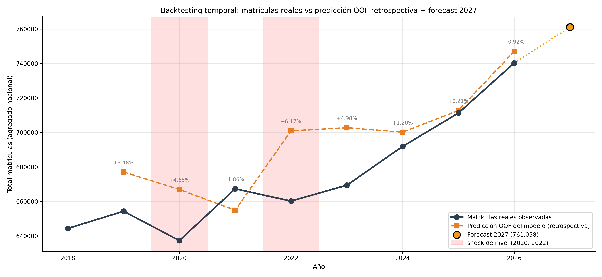
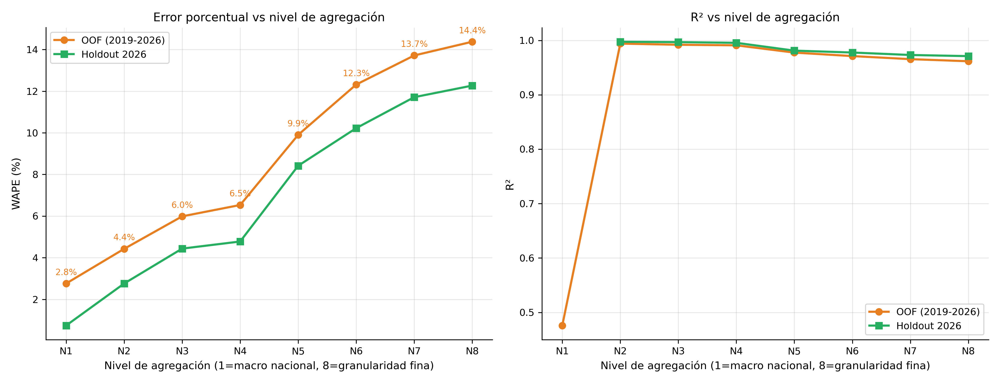
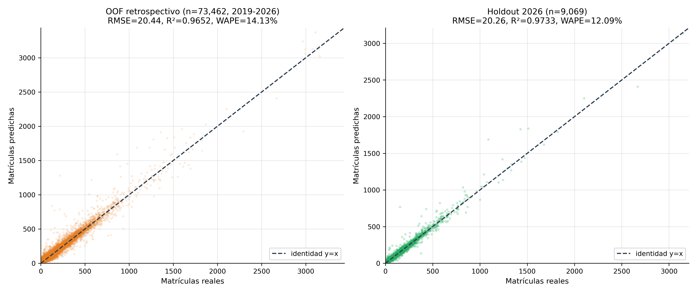
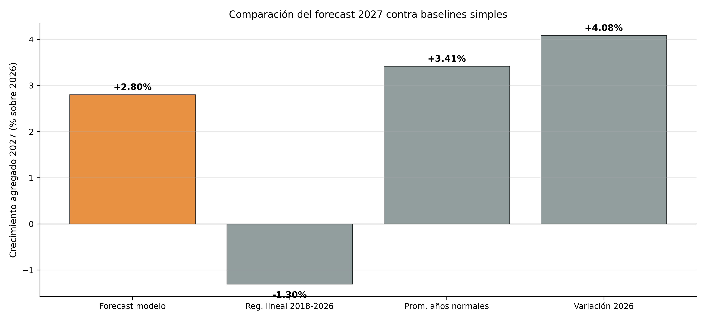

<div align="center">

# 🎓 Predicción de la dinámica de matrícula universitaria en Chile

### _Machine learning_ a granularidad de programa, validado contra la matrícula real 2026, con pronóstico 2027 pre-registrado, intervalos conformes y una advertencia sobre el baseline

[](https://www.python.org/)
[](LICENSE)
[](#-estado-y-versiones)
[](#-pronóstico-2027-pre-registrado)
[](#-validación-contra-el-dato-real-2026)
[](https://catboost.ai)
[](https://optuna.org)
[](https://shap.readthedocs.io)
[](https://huggingface.co/spaces/diegoevans2-arch/prediccion-dinamica-matricula-universitaria-chile)

</div>

---

> **TL;DR** — Pronóstico de matrícula universitaria chilena a granularidad fina (institución × carrera × región × jornada × género × condición × año), integrando 10 fuentes oficiales (7 bases públicas y 3 diccionarios de llaves). Entrenado sólo con datos hasta 2025 y contrastado contra la matrícula real 2026 publicada por el SIES, el modelo obtuvo **WAPE 11,49 % frente a 12,69 % de la persistencia**, un **_skill score_ de +26,71 % positivo en los 8 niveles de agregación** y un **error agregado de −0,01 %** sobre 721.747 matrículas. Re-estimado con datos hasta 2026 y el mismo método, pronostica para 2027 **761.058 matrículas (+2,80 %)**, publicadas antes del dato oficial. Las predicciones de v4 contrastadas contra el real 2026 llevan **intervalo al 90 %** por _conformal prediction_, con cobertura verificada de 92,5 %; los de la corrida 2027 se calibraron con el mismo método, y en su holdout 2026 cubren el 92,35 % de las celdas. El total 2027 lleva un rango indicativo de **716.850 a 775.499** matrículas, no conforme: ocho observaciones anuales no alcanzan para un cuantil con garantía. El hallazgo más transferible es metodológico: **el baseline naïve es la misma columna que el lag del modelo**, y un defecto en esa llave sesga el _skill score_ sin que ningún diagnóstico habitual lo detecte.

> [!NOTE]
> **Actualización de noviembre de 2026.** Con la matrícula 2026 del SIES y la base INDICES del CNED de agosto de 2026, el pipeline v4 se volvió a ejecutar sin cambios de método: entrena con 2018-2025, se evalúa a ciegas sobre 2026 y pronostica 2027. El pronóstico 2027 queda **publicado** en este repositorio antes del dato oficial y será la primera prueba limpia del pipeline corregido; su **congelamiento formal** —huella SHA-256 de modelo, metadata y predicciones, y etiqueta git anotada publicada en el remoto— está **pendiente** y debe completarse antes del 30-06-2027 (§24.5 del documento técnico). Los notebooks dejaron de publicarse: el método completo está en el [documento técnico funcional](Documents/DOCUMENTO_TECNICO_FUNCIONAL.md). Paper v4: [Markdown](Documents/OUTPUTS_PAPER/paper_modelo_matricula_chile_v4.md) · [PDF](Documents/paper_modelo_matricula_chile_v4.pdf). Las observaciones abiertas de la revisión de noviembre de 2026 están en [OBSERVACIONES_Y_MEJORAS.md](OBSERVACIONES_Y_MEJORAS.md).

> [!IMPORTANT]
> **Si viste este repositorio en junio de 2026, esas cifras ya no son válidas.** La versión anterior (v3) reportaba R² = 0,936, un _skill_ de +77,4 % sobre el naïve, un forecast 2026 de 707.960 y «99,98 % de confianza» nacional. Al contrastar ese pronóstico —congelado el 17 de junio— contra el dato real 2026, el _skill_ resultó **−8,0 %**. La auditoría encontró dos defectos en la llave del lag que corrompían el target **y el propio baseline**. Corregidos, el modelo se reestimó en agosto con la misma ventana (≤2025) y sin ver ningún dato de 2026. Las cifras de validación contra el real 2026 de este README son de esa versión (v4). Son _out-of-sample_, pero no pre-registradas: la prueba limpia es el pronóstico 2027.

---

## 📑 Tabla de contenidos

- [Resumen ejecutivo](#-resumen-ejecutivo)
- [Resultados destacados](#-resultados-destacados)
- [Pronóstico 2027 (pre-registrado)](#-pronóstico-2027-pre-registrado)
- [Validación contra el dato real 2026](#-validación-contra-el-dato-real-2026)
- [Arquitectura del pipeline](#-arquitectura-del-pipeline)
- [Fuentes de datos](#-fuentes-de-datos)
- [Pipeline de procesamiento](#-pipeline-de-procesamiento)
- [Estructura del repositorio](#-estructura-del-repositorio)
- [Cómo replicar](#-cómo-replicar)
- [Hallazgos metodológicos](#-hallazgos-metodológicos)
- [Limitaciones](#%EF%B8%8F-limitaciones)
- [¿Y los IP y CFT? La próxima frontera](#-y-los-ip-y-cft-la-próxima-frontera)
- [Estado y versiones](#-estado-y-versiones)
- [Citar este trabajo](#-citar-este-trabajo)
- [Autor](#-autor)
- [Licencia](#-licencia)

---

## 📊 Resumen ejecutivo

### Qué hace este proyecto

Predice cuántos estudiantes se matricularán en cada combinación de **institución × carrera × región × jornada × género × condición** del sistema universitario chileno. Genera predicciones retrospectivas validadas (2019-2026), el **contraste del forecast 2026 contra la matrícula real** publicada por el SIES el 10 de julio de 2026 y un **forecast 2027** publicado antes del dato oficial.

### Para quién es útil, y hasta dónde

| ✅ Sirve para | ❌ No sirve para |
|---|---|
| Proyectar una universidad completa — 49 de 53 dentro de ±10 % | Predecir qué programa individual crece — sólo 43,3 % de las celdas dentro de ±10 % |
| Proyectar una facultad (institución × área) — 82,4 % dentro de ±10 % | Dimensionar la modalidad a distancia — creció +7,3 % y el modelo le puso +16,3 % |
| Proyectar el subsector universitario — error agregado de −0,01 % | Un titular nacional sin ajuste — cubre el 95,1 % de la matrícula y lo excluido crece más rápido |
| Mejorar a la persistencia dentro de cada institución — lo hace en 42 de 53 | Alertar una caída institucional — subestimó la caída de las 14 instituciones que cayeron en 2026 |

- 🏛️ **Política pública**: proyección agregada del subsector universitario con bandas de cobertura verificada.
- 🎓 **Universidades**: proyección institucional y por facultad, con su banda al 90 % (verificada en la validación 2026 de v4 y en el holdout 2026 de la corrida 2027). No reemplaza el juicio experto a nivel de carrera.
- 🔬 **Investigación en ML aplicado a educación**: un caso documentado de cómo un defecto en la llave del lag contamina modelo y baseline a la vez, evidencia sobre _target encoding_ fold-aware y un contraste _out-of-time_ con su estatus epistémico declarado.

### Pregunta de investigación

¿Se puede pronosticar matrícula universitaria chilena a granularidad de programa con una ventaja medible sobre la persistencia, y hasta qué nivel de agregación sirve ese pronóstico?

**Respuesta: sí, con límites declarados.** Contra el dato real 2026 el modelo le gana a la persistencia en los ocho niveles de agregación, pero la utilidad práctica llega hasta **institución × área × región**: ahí tres de cada cuatro grupos caen dentro de ±10 %. Al agregar la carrera, sólo uno de cada dos.

---

## 🎯 Resultados destacados

### Desempeño global, siempre con la persistencia al lado

La matrícula es tan inercial que predecir «igual que el año pasado» ya alcanza un R² de 0,97. **Un R² suelto no dice nada en este dominio**: lo que mide el aporte del modelo es la distancia contra esa referencia. Por eso ninguna métrica de este repositorio se publica sin su baseline al lado.

| Conjunto | Modelo | n | R² | R² naïve | WAPE | WAPE naïve | **Skill** | MASE | Sesgo |
|---|---|---:|---:|---:|---:|---:|---:|---:|---:|
| OOF retrospectivo (2019-2026) | corrida 2027 | 73.462 | 0,9652 | 0,9653 | 14,13 % | 14,63 % | **−0,47 %** | 0,9656 | +2,40 % |
| Holdout 2026 (ciego) | corrida 2027 | 9.069 | 0,9733 | 0,9689 | 12,09 % | 12,91 % | **+14,20 %** | 0,9363 | +0,92 % |
| Holdout 2025 (ciego) | v4 | 9.041 | 0,9794 | 0,9735 | 12,24 % | 13,12 % | **+22,46 %** | 0,9327 | −0,20 % |
| **Real 2026 (_out-of-time_)** | v4 | 8.729 | **0,9760** | 0,9673 | **11,49 %** | 12,69 % | **+26,71 %** | **0,9055** | **−0,01 %** |

«v4» es el modelo entrenado hasta 2025; «corrida 2027», el mismo pipeline entrenado hasta 2026. El _skill_ del OOF completo es bajo porque los años tempranos se entrenan con muy poca historia: el modelo es peor que la persistencia en cuatro de los ocho años retrospectivos, y el _skill_ es positivo en 2024, 2025 y 2026. El holdout 2026 y la validación de v4 miden el mismo año con instrumentos distintos —exógenas observadas frente a congeladas, universo de celdas distinto—; ninguna corrige a la otra.

**Cómo leer el _skill_.** El _skill score_ se calcula sobre el error cuadrático, no sobre el WAPE: **skill = 1 − (RMSE<sub>modelo</sub> / RMSE<sub>naïve</sub>)²** (Murphy, 1988), es decir, la fracción del error cuadrático medio de la persistencia que el modelo elimina. Positivo significa que el modelo mejora a la persistencia; cero, que la iguala; negativo, que es peor. El MASE es el cociente entre el MAE del modelo y el de la persistencia (Hyndman y Koehler, 2006): menor que 1 es mejor. Como el WAPE y el MASE ponderan los errores absolutos y el RMSE los eleva al cuadrado, las métricas pueden discrepar: en el OOF retrospectivo el modelo tiene **menor WAPE** que la persistencia (14,13 % frente a 14,63 %) y MASE < 1, pero un **_skill_ de −0,47 %**, porque unos pocos errores grandes —la tabla de peores predicciones está dominada por 2019 y 2020— pesan más en el RMSE que en el error absoluto.

### 🎨 Visualizaciones clave

<div align="center">

**Backtesting temporal: matrícula real vs predicción OOF retrospectiva + forecast 2027**



**Evolución del error al cambiar la granularidad de agregación (OOF y holdout 2026)**



**Predicciones vs valores reales: OOF retrospectivo y holdout 2026**



</div>

La exploración interactiva de la validación 2026 —cascada, desagregados, benchmark por institución y las 8.729 celdas con su banda— está en el **[dashboard público](https://huggingface.co/spaces/diegoevans2-arch/prediccion-dinamica-matricula-universitaria-chile)**.

---

## 🔮 Pronóstico 2027 (pre-registrado)

El pipeline v4, re-estimado con datos hasta 2026, pronostica **761.058 matrículas** para 2027 en 9.069 celdas de 53 universidades con programas vigentes en 2026: **+2,80 %** sobre las 740.318 matrículas reales de esas celdas. Se publica antes de que el SIES publique la matrícula 2027 (julio de 2027) y no se modificará después.

> [!WARNING]
> **Congelamiento pendiente.** El protocolo de congelamiento (§24.5 del [documento técnico](Documents/DOCUMENTO_TECNICO_FUNCIONAL.md)) exige registrar en este repositorio la huella SHA-256 de modelo, metadata y predicciones, crear una etiqueta git anotada con la huella de las predicciones y publicarla en el remoto antes del 30-06-2027: «un registro sólo local no prueba nada». A la fecha de esta revisión (noviembre de 2026) no hay huella publicada ni etiqueta; la cifra está publicada, pero aún no formalmente congelada. Los intervalos al 90 % de esta corrida ya están calibrados (P-05, resuelto el 19-11-2026; ver «Banda al 90 %» abajo).

| Referencia | Crecimiento 2027 |
|---|---:|
| **Forecast del modelo** | **+2,80 %** |
| Promedio de las variaciones 2024-2026 | +3,41 % |
| Variación 2026 | +4,08 % |
| Regresión lineal 2018-2026 | −1,30 % |

- **Composición**: crecen los alumnos antiguos (+3,65 %) y caen levemente los nuevos (−0,49 %). La modalidad diurna crece 2,3 %, la vespertina cae 5,5 % y la modalidad a distancia crece 16,5 %; esa última cifra merece cautela, porque en 2026 el modelo ya sobreestimó la modalidad a distancia (+16,3 % pronosticado, +7,3 % real).
- **Precisión esperable**: en el holdout 2026 el modelo le gana a la persistencia en los ocho niveles de agregación, con WAPE de 2,60 % por institución y 12,09 % en la celda fina.
- **Banda al 90 %**: calibrada con el mismo procedimiento conforme de v4 sobre los residuos de esta corrida. Calibrando con el OOF 2019-2025, la cobertura en el holdout 2026 fue de 92,35 % por celda (ancho mediano: 36,5 matrículas) y de 92,2 % a 94,3 % en los niveles N2 a N8. Para el pronóstico, la calibración usa el OOF 2019-2026. Por institución, la banda mediana mide 20,4 % del valor pronosticado. El total nacional no lleva banda conforme, sino un rango indicativo de 716.850 a 775.499, construido con los errores agregados OOF (−1,86 % a +6,17 %); es conservador, porque los años tempranos sobre-predecían.
- **Supuestos declarados**: el PIB regional y la desocupación de 2026 se arrastran desde 2025, porque no estaban publicados; las exógenas de 2027 se congelan en su último valor observado; la base INDICES del CNED cubre 2026 sólo en parte.
- **Cobertura**: como en 2026, la cifra cubre sólo programas que existían el año anterior con al menos 10 matriculados. No es el titular nacional del SIES.

<div align="center">



</div>

Detalle en la sección 5.9 del [paper](Documents/OUTPUTS_PAPER/paper_modelo_matricula_chile_v4.md).

---

## ✅ Validación contra el dato real 2026

Esta sección mide el modelo v4, entrenado hasta 2025. El modelo pronosticó **727.260** matrículas para 2026. De las 759.045 matrículas universitarias de pregrado que registró el SIES, el pronóstico empareja **721.747 (95,09 %)** en 8.729 celdas, donde predijo **721.649**: un error agregado de **−98 estudiantes (−0,01 %)**. El crecimiento predicho en esas celdas fue **+2,26 %** y el observado **+2,27 %**.

### Cascada macro → micro

| Nivel | n grupos | WAPE | WAPE naïve | **Skill** | MASE | ±10 % | ±10 % naïve |
|---|---:|---:|---:|---:|---:|---:|---:|
| N1 Nacional | 1 | 0,01 % | 2,32 % | +99,99 % | 0,006 | 100 % | 100 % |
| N2 + Institución | 53 | 2,31 % | 3,26 % | +48,46 % | 0,708 | 92,5 % | 92,5 % |
| N3 + Área | 408 | 3,74 % | 4,76 % | +48,93 % | 0,786 | 82,4 % | 77,9 % |
| N4 + Región | 649 | 4,16 % | 5,02 % | +37,52 % | 0,829 | 76,4 % | 73,2 % |
| N5 + Carrera | 2.668 | 7,59 % | 8,48 % | +24,54 % | 0,895 | 58,4 % | 57,0 % |
| N6 + Condición | 4.633 | 9,42 % | 10,47 % | +25,59 % | 0,900 | 50,9 % | 49,1 % |
| N7 + Género | 8.094 | 10,93 % | 11,97 % | +22,82 % | 0,914 | 44,6 % | 42,3 % |
| N8 + Jornada (celda fina) | 8.729 | 11,49 % | 12,69 % | **+26,71 %** | 0,906 | 43,3 % | 40,9 % |

**El _skill_ es positivo y el MASE menor que 1 en los ocho niveles**: no hay un nivel en que convenga usar la persistencia en lugar del modelo.

### Dónde falla

- **Comprime hacia la media.** La correlación entre la tasa de crecimiento real y la predicha por celda es 0,365, la dispersión predicha es menos de la mitad de la real y la dirección del cambio es correcta en el 60 % de las celdas. **Dimensiona, no rankea.**
- **Por institución, los errores tiran hacia el centro.** El pronóstico quedó por encima del real en las 14 instituciones que cayeron —aunque anticipó la caída en 10— y por debajo en 30 de las 39 que crecieron. De las 20 instituciones para las que anticipó una caída, sólo 10 cayeron: no es una alerta temprana de contracción.
- **La modalidad a distancia** creció +7,3 % y el modelo le asignó +16,3 %: prolongó el ritmo de los años previos justo cuando la expansión se moderó.
- **La cobertura no es neutral.** Quedan fuera los programas nuevos y los de menos de 10 matriculados, un segmento que creció +29 %. Todo uso como titular nacional sub-predice de forma estructural.

### Intervalos de predicción

_Conformal prediction_ dividida y estratificada por tamaño de celda, calibrada en la escala de la tasa. Los agregados no se suman: cada nivel se calibra sobre su propio error.

| Conjunto | n | Cobertura al 90 % | Ancho mediano |
|---|---:|---:|---:|
| Holdout 2025 | 9.041 | 91,54 % | 36,3 |
| Real 2026 | 8.729 | **92,53 %** | 37,3 |

Los intervalos son conservadores, y se sabe por qué: la calibración incluye los años OOF tempranos, que sobre-predecían. El total nacional no lleva banda conforme —siete observaciones anuales no alcanzan—, sólo un rango indicativo de 681.899 a 742.062.

---

## 🏗️ Arquitectura del pipeline

```
┌─ 1 · FUENTES PÚBLICAS (7) + DICCIONARIOS (3) = 10 ──────────────────────┐
│ SIES matrícula 2007-2026 · CNED aranceles y puntajes · CNED docentes    │
│ CNED inmuebles · Banco Central PIB regional · INE desocupación          │
│ mifuturo.cl retención · diccionarios de instituciones, carreras         │
│ y sede-región                                                           │
└────────────────────────────────────┬────────────────────────────────────┘
                                     ▼
┌─ 2 · INGESTA POR FUENTE ────────────────────────────────────────────────┐
│ Limpieza, formato largo (género × condición), controles de              │
│ conservación: 22.357.425 matrículas de pregrado, sin pérdida            │
└────────────────────────────────────┬────────────────────────────────────┘
                                     ▼
┌─ 3 · CONSOLIDACIÓN ─────────────────────────────────────────────────────┐
│ Llaves canónicas → merge SIES-céntrico (6 uniones, sin inflado)         │
│ → arrastre de exógenas → imputación jerárquica (5 capas)                │
│ → llave del lag en cascada: nombre → código → grupo escalado            │
│ → target arcsinh, variables derivadas, filtro lag ≥ 10                  │
│ Salida: dataset de 82.967 celdas-año 2018-2026 · 49 variables           │
└────────────────────────────────────┬────────────────────────────────────┘
                                     ▼
┌─ 4 · MODELADO ──────────────────────────────────────────────────────────┐
│ Shocks detectados (2020 y 2022) · expanding window de 7 folds           │
│ TE fold-aware · baselines B0-B3 + persistencia · Optuna 50 trials       │
│ CatBoost: holdout 2026 WAPE 12,09 % vs 12,91 % · skill +14,2 %          │
│ OOF 2019-2026 · refit 2018-2026 · pronóstico 2027: 761.058              │
└────────────────────────────────────┬────────────────────────────────────┘
                                     ▼
┌─ 5 · ANÁLISIS ──────────────────────────────────────────────────────────┐
│ Métricas con la persistencia al lado · cascada macro → micro (8)        │
│ Backtesting temporal · SHAP · intervalos conformes al 90 %              │
└────────────────────────────────────┬────────────────────────────────────┘
                                     ▼
┌─ CONGELAMIENTO (PENDIENTE) ─────────────────────────────────────────────┐
│ Pronóstico 2027: huella SHA-256 + etiqueta git anotada en el remoto,    │
│ aún no realizado · plazo: antes del 30-06-2027 (doc. técnico §24.5)     │
└────────────────────────────────────┬────────────────────────────────────┘
                                     ▼
┌─ 6 · VALIDACIÓN OUT-OF-TIME ────────────────────────────────────────────┐
│ SIES del año pronosticado, emparejado por celda, contra persistencia    │
│ Evidencia v4 vs real 2026: skill +26,7 % · error agregado −0,01 %       │
└─────────────────────────────────────────────────────────────────────────┘
```

---

## 📂 Fuentes de datos

Todas las fuentes son **públicas y oficiales**. Pueden descargarse directamente desde los organismos correspondientes:

| Fuente | Organismo | Variables aportadas | Período | URL oficial |
|---|---|---|---|---|
| **Base de matrículas SIES** | MINEDUC | Matrícula por institución × carrera × jornada × género × condición × año | 2018-2026 | [mifuturo.cl/bases-de-datos](https://www.mifuturo.cl/bases-de-datos-de-matriculados/) |
| **BaseINDICES CNED** | CNED | Aranceles, vacantes, puntajes de admisión, duración de carreras | 2005-2026 (2026 parcial) | [cned.cl/indices](https://www.cned.cl/bases-de-datos) |
| **Cuerpo Docente CNED** | CNED | Número de docentes por grado académico y jornada | 2018-2025 | [cned.cl/indices](https://www.cned.cl/bases-de-datos) |
| **Inmuebles e infraestructura CNED** | CNED | M² construidos, salas, oficinas por sede | 2018-2025 | [cned.cl/indices](https://www.cned.cl/bases-de-datos) |
| **PIB regional** | Banco Central de Chile | PIB regional anual a precios corrientes (MM$) | 2018-2025 (2026 arrastrado) | [bcentral.cl](https://www.bcentral.cl/web/banco-central/areas/estadisticas) |
| **Tasa de desocupación regional** | INE (SIMEL) | Tasa de desempleo anual por región y sexo | 2018-2025 (2026 arrastrado) | [ine.gob.cl](https://www.ine.gob.cl/) |
| **Buscador de Empleabilidad e Ingresos** | mifuturo.cl | Retención de primer año, empleabilidad por carrera-institución | 2018-2025 | [mifuturo.cl](https://www.mifuturo.cl/) |
| **Diccionario sede-región CNED** | CNED | Mapeo de códigos de sede a códigos INE de región (380 sedes) | Estático | CNED |
| **Diccionario de instituciones** | SIES | Catálogo canónico de 220 instituciones | Estático | MINEDUC |
| **Diccionario de carreras** | SIES | Catálogo canónico de 15.940 nombres de carrera | Estático | MINEDUC |

> ⚠️ **Nota sobre las bases de datos**: el repositorio NO incluye las bases originales ni el consolidado intermedio. Las fuentes son todas públicas y descargables desde los organismos. La construcción del dataset es trazable desde el [documento técnico funcional](Documents/DOCUMENTO_TECNICO_FUNCIONAL.md).

> ✔️ **Guardarraíl externo**: las cifras del informe oficial del SIES 2026 —1.497.548 matrículas totales, 1.372.167 de pregrado y 759.045 en universidades— se reproducen **exactamente** desde el CSV crudo. Es la verificación de que la ingesta interpreta la fuente igual que su emisor.

---

## 🔧 Pipeline de procesamiento

El código fuente no se publica. Cada etapa —entradas, reglas, validaciones de control y salidas— está descrita en el **[documento técnico funcional](Documents/DOCUMENTO_TECNICO_FUNCIONAL.md)**, con el detalle necesario para reproducirla o auditarla. Lo que sigue es el resumen.

### 1️⃣ Ingesta y ETL por fuente

Cada fuente tiene su propio proceso de ETL, responsable de:

- **Carga** con la codificación y los separadores de cada fuente.
- **Validación de integridad**: nulos, duplicados, rangos esperados, cardinalidad.
- **Normalización**: regiones contra diccionario canónico, códigos institucionales contra SIES, nombres de carrera contra la base canónica.
- **Transformación específica**: agregación a la granularidad apropiada y cálculo de ratios estructurales.

### 2️⃣ Consolidación

El consolidado integra las fuentes con un **merge SIES-céntrico**: todas las uniones parten de la matrícula, de modo que ninguna fila se pierde por ausencia en una fuente secundaria ni aparecen filas espurias. Cuando una fuente todavía no publica el último año, el pipeline arrastra su valor más reciente y lo registra; en la corrida 2027 eso ocurrió con el PIB y la desocupación de 2026.

Las celdas vacías se completan con **imputación jerárquica de 5 capas**, de lo específico a lo general: (1) temporal —interpolación sobre el año para docentes e inmuebles—; (2) jerárquica —(institución, carrera) → (institución, área, año) → (área, año)— para aranceles y retención; (2.5) región-carrera; (2.7) institución; (3) terminal, mediana global. Una bandera `fue_imputado` marca cada fila: **el 70,9 % tiene al menos una variable imputada** (67,3 % en v4), concentrada en aranceles y retención. En v4, esas filas tenían un WAPE 75 % mayor, pero la persistencia —que no usa ninguna variable imputada— mostraba casi la misma brecha: son celdas más pequeñas y difíciles, no necesariamente peor modeladas.

#### 🔑 La llave del lag

`matriculas_lag1` es la matrícula del año anterior en la misma celda, y es **a la vez** la variable de inercia del modelo y el pronóstico de persistencia contra el que se mide. Se construye con tres niveles de respaldo:

| Nivel | Llave de emparejamiento |
|---|---|
| Fino | institución, nombre de carrera, región, jornada, género, condición |
| Código | institución, código de carrera, región, jornada, género, condición |
| Medio | institución, código de carrera, región — escalado por la participación de la celda |

El respaldo por **código** sobrevive a los renombres de carrera del SIES, y el nivel medio se **escala por participación** para que numerador y denominador de la tasa compartan el grano. De las 82.967 filas, 97,9 % se emparejan en el nivel fino, 0,8 % por código y 1,2 % por el nivel medio escalado.

El dataset consolidado tiene **82.967 filas** (2018-2026), 49 _features_ para el modelo, **62 universidades**, **1.432 nombres de carrera canónicos**, 16 regiones y 10 áreas del conocimiento.

### 3️⃣ Modelado predictivo

- **Target**: tasa de crecimiento de matrícula, transformada con `arcsinh` y winsorizada al 1 %/99 %; las predicciones se reconstruyen a matrículas absolutas.
- **Detección automatizada de shocks pandémicos** (Z-score sobre media y dispersión del target + variación agregada) → clasifica **2020 y 2022 como shock de nivel** en ambas corridas; las categorías de dispersión y recaída quedan vacías.
- **Validación temporal estricta**: _expanding window_ de **7 folds** (validación 2019-2025) + **holdout ciego 2026**.
- **Target encoding fold-aware** con suavizado por ponderación sigmoide, ajustado sólo con los datos de entrenamiento de cada _fold_.
- **Baselines informados**: B0 (mediana), B1 (histórica por institución-carrera), B2 (Ridge sólo lag), B3 (Ridge full), más la **persistencia** sobre niveles absolutos.
- **Modelos candidatos**: LightGBM, XGBoost, CatBoost y Random Forest como control.
- **Optimización con Optuna**: 50 _trials_ por modelo. **CatBoost** queda como modelo final (RMSE CV = 0,2949 en escala `arcsinh`) aunque terminó **tercero**, detrás de XGBoost (0,2933) y LightGBM (0,2943). La diferencia es de 0,5 %; la elección se mantiene entre corridas para que el pronóstico 2027 sea el del mismo método validado en 2026.
- **Experimento TE-leaky vs TE-fold-aware**: el _target encoding_ precalculado reporta un RMSE **3,2 %** mejor (3,5 % en v4). Los dos brazos también difieren en la fórmula de suavizado, así que la cifra no aísla sólo la fuga.
- **Predicciones OOF retrospectivas** 2019-2026 y **forecast 2027**.

### 4️⃣ Análisis para el paper

Sobre las predicciones —sin re-entrenar nada— se producen las **12 figuras** y **9 tablas** de [`Documents/OUTPUTS_PAPER/`](Documents/OUTPUTS_PAPER/): métricas globales, cascada macro → micro, desempeño por año y por región, backtesting nacional, calibración, forecast contra baselines simples, errores extremos y SHAP. Todas corresponden a la corrida 2027.

### 5️⃣ Validación _out-of-time_ e intervalos

El contraste de v4 contra la matrícula real 2026 y los intervalos conformes se calculan sobre el export de predicciones. Métodos y resultados completos en las secciones 4.10, 5.4 y 5.5 del [paper](Documents/OUTPUTS_PAPER/paper_modelo_matricula_chile_v4.md).

---

## 📁 Estructura del repositorio

```
Predictive-Model-of-University-Admission---Latam-CL/
│
├── 📄 README.md                                    # Este documento
├── 📄 OBSERVACIONES_Y_MEJORAS.md                   # Observaciones de la revisión (nov-2026) y tareas abiertas
├── 📄 LICENSE                                      # Licencia MIT
├── 📄 .gitattributes
├── 📄 .gitignore
│
├── 📂 Documents/
│   ├── paper_modelo_matricula_chile_v4.pdf            # Paper v4 completo (PDF)
│   ├── Predictive model of university admission.pdf   # PDF de v3, obsoleto (pendiente de eliminación)
│   ├── DOCUMENTO_TECNICO_FUNCIONAL.md                 # Descripción funcional completa del pipeline
│   ├── OFICIAL_GLOSARIO_MATRICULA_WEB_E.pdf           # Glosario oficial SIES
│   ├── BaseINDICES-2005-2025_*.pdf                    # Documentación CNED
│   ├── INDICES_Institucional_2005-2025_*.pdf          # Documentación CNED
│   │
│   └── OUTPUTS_PAPER/
│       ├── paper_modelo_matricula_chile_v4.md         # Paper completo en Markdown
│       │
│       ├── figuras/                # 12 figuras del análisis (PNG 300 dpi)
│       │   ├── fig01_distribucion_residuos.png
│       │   ├── fig02_scatter_pred_vs_real.png
│       │   ├── fig03_metricas_por_anio.png
│       │   ├── fig04_wape_por_region.png
│       │   ├── fig05_macro_a_micro.png
│       │   ├── fig06_evolucion_metricas_por_nivel.png
│       │   ├── fig07_calibracion.png
│       │   ├── fig08_backtesting_temporal_MONEY_FIGURE.png
│       │   ├── fig09_forecast_2027_vs_baselines.png
│       │   ├── fig09_validacion_forecast_2026.png     # nombre antiguo (pendiente de eliminación)
│       │   ├── fig10_shap_top5_distribucion.png
│       │   ├── fig11_shap_por_subgrupo.png
│       │   └── fig12_caso_estudio_shap.png
│       │
│       └── tablas/                 # 10 tablas en formato Markdown
│           ├── tabla_resumen_paper.md
│           ├── tabla_macro_a_micro_OOF.md
│           ├── tabla_macro_a_micro_HOLDOUT.md
│           ├── tabla_metricas_por_anio.md
│           ├── tabla_metricas_por_region.md
│           ├── tabla_backtesting_anual.md
│           ├── tabla_shap_top5_resumen.md
│           ├── tabla_top15_mejores_predicciones.md
│           ├── tabla_top15_peores_predicciones.md
│           └── tabla_peores_por_origen_lag.md   # errores por origen de la llave del lag (B-07)
```

Las bases originales no se publican: son públicas y se descargan desde cada organismo (ver [Fuentes de datos](#-fuentes-de-datos)).

---

## 🔄 Cómo replicar

El código no se publica, pero el método sí, con el detalle necesario para reconstruirlo:

1. **Obtener las fuentes.** Descarga cada base desde el organismo oficial, en la edición indicada en [Fuentes de datos](#-fuentes-de-datos) y en el documento técnico funcional.
2. **Reproducir la ingesta y la consolidación.** El [documento técnico funcional](Documents/DOCUMENTO_TECNICO_FUNCIONAL.md) describe, por fuente, las reglas de limpieza, la normalización de llaves, el orden de las uniones, la llave del lag y la imputación, con los controles que deben cumplirse en cada etapa.
3. **Verificar contra las cifras oficiales.** La matrícula de pregrado y la universitaria por año deben coincidir con los informes del SIES; es el primer guardarraíl antes de modelar.
4. **Reproducir el modelado.** El documento describe el target, las variables, la validación temporal, los modelos, la optimización y las métricas. Las cifras de este README y del paper sirven de referencia para comparar.

El entorno con que se produjeron las corridas usa Python 3.12, scikit-learn, LightGBM, XGBoost, CatBoost, Optuna, SHAP y `category_encoders`. La optimización con Optuna tarda del orden de horas en un equipo de escritorio.

> ⚠️ `shap` 0.45.1 no puede explicar modelos de `xgboost` 3.x (`TreeExplainer` falla al leer `base_score`). Es una de las razones por las que el modelo final es CatBoost y no XGBoost, que ganó el tuning.

---

## 🔬 Hallazgos metodológicos

### 1. El naïve _es_ el lag

El baseline de persistencia y la variable de inercia del modelo son **la misma columna**. Cuando esa columna tiene un defecto, el _skill score_ —un cociente entre ambos— se contamina arriba y abajo, en una dirección que no se puede anticipar. En este proyecto, dos fallas en la llave del lag —renombres de carrera del SIES sin respaldo por código, y un nivel de respaldo que agregaba jornada, género y condición sólo en el denominador— corrompían cerca del 4 % de los targets **y el baseline en la misma proporción**. El mismo defecto infló el _skill_ del holdout 2025 hasta +77,4 % y lo hundió a −8,0 % en 2026.

Lo peligroso es que era **invisible**: curvas de aprendizaje, residuos e importancia de variables seguían siendo razonables. Sólo se delató como un salto implausible del _skill_ entre dos años. Recomendaciones:

1. Auditar la llave del lag como se audita el target, y publicar la tasa de emparejamiento por nivel de respaldo.
2. Vigilar la distribución del lag, no sólo la del target: una razón lag/celda con mediana de 8× es detectable antes de entrenar.
3. Tratar los saltos grandes de _skill_ entre períodos como sospecha de instrumento, no como hallazgo sobre el fenómeno.
4. Verificar la consistencia de grano: numerador y denominador de una tasa deben compartir la llave.

### 2. El R² es engañoso en este dominio

En el holdout 2026 el modelo alcanza R² = 0,9733 y la persistencia pura, 0,9689 (0,9794 y 0,9735 en el holdout 2025 de v4). Un programa de cinco años arrastra cuatro cohortes ya matriculadas: casi todo el nivel del año siguiente está determinado antes de que empiece la admisión. **Ningún R² sobre niveles de matrícula debería publicarse sin el R² de su persistencia al lado.** Las métricas informativas son el _skill score_, el MASE y el porcentaje de grupos dentro de una banda declarada.

### 3. Target encoding fold-aware vs precalculado

Un _target encoding_ precalculado sobre todo el dataset reporta un RMSE **3,2 % mejor** del que el modelo alcanza realmente (0,2853 frente a 0,2949; 3,5 % en v4). En este mismo trabajo, la diferencia de RMSE entre los tres candidatos de _gradient boosting_ (0,5 %) es menor que ese sesgo: un solo error de este tipo puede invertir el ranking aparente. Una salvedad: el TE precalculado usa el estimador _m_ y el _fold-aware_ una ponderación sigmoide, de modo que la cifra mide el atajo tal como está implementado y no la fuga aislada.

### 4. La precisión crece con la agregación, y la frontera está entre N4 y N5

En la validación de v4 contra el real 2026, el WAPE baja de 11,49 % en la celda fina a 0,01 % en el total nacional; en el holdout 2026 de la corrida 2027, de 12,09 % a 0,92 %. En ambos, hasta institución × área × región, tres de cada cuatro grupos caen dentro de ±10 %; al agregar la carrera, poco más de la mitad. El modelo sirve para dimensionar agregados, no para decidir sobre programas individuales.

### 5. Tasa y nivel

Sobre la tasa de crecimiento el R² es del orden de 0,10; sobre el nivel absoluto, 0,98. Es la misma inercia vista desde los dos lados: casi todo el nivel es anticipable y casi nada del crecimiento marginal lo es. Ambas cifras son ciertas, y reportar sólo la segunda exagera lo que hace el modelo.

### 6. Detección de shocks: qué quedó en pie

El procedimiento automatizado clasifica 2020 y 2022 como shock de nivel, también con 2026 incluido. La versión anterior reportaba una clasificación tripartita —nivel, dispersión, recaída— que **no se reproduce** tras corregir la llave del lag. Lo que sobrevive es el procedimiento, un criterio explícito y reproducible para marcar años, no la afirmación de que existan tres tipos de shock. Que la clasificación cambie con el preprocesamiento es en sí una limitación.

---

## ⚠️ Limitaciones

- **El componente extrapolativo es nulo.** Los árboles no extrapolan el año, y las exógenas (PIB, desempleo, aranceles, docentes) se congelan en su último valor observado: en la práctica el forecast es una transformación aprendida del lag.
- **La validación 2026 de v4 es _out-of-sample_ pero no pre-registrada.** El dato real 2026 motivó la auditoría que produjo esa versión. No hubo fuga —la ventana sigue cerrada en 2025 y el defecto era verificable con datos ≤2025—, pero la prueba limpia es el pronóstico 2027.
- **Exógenas arrastradas.** El PIB regional y la desocupación de 2026 no estaban publicados y se arrastraron desde 2025; el modelo ve un 2026 macroeconómico idéntico a 2025.
- **Variables con información del año evaluado.** `densidad_estudiantes_m2`, `ratio_docente_estudiante` y `matriculas_sobre_pib` usan la matrícula agregada del mismo año que se predice, y las exógenas entran con su valor de ese año. Las métricas retrospectivas (OOF y holdout) pueden ser optimistas. El forecast no tiene el problema —esas variables quedan congeladas en el último año observado—, pero falta una ablación que mida el efecto.
- **Fuga de hiperparámetros al OOF retrospectivo.** Se optimizan una vez sobre el CV y se reutilizan en los años tempranos, cuyas cifras deben leerse como indicativas. El holdout y el forecast no tienen este problema.
- **El baseline de detección de shocks incluye el año de holdout** (2026 en la corrida 2027). La contaminación es mínima, pero real.
- **Cobertura**: sólo universidades (62 instituciones, unas 759.000 matrículas de pregrado en 2026). Dentro del subsector, el modelo cubre el 95,09 % de la matrícula; quedan fuera los programas nuevos y los de menos de 10 matriculados.
- **Ñuble sin datos institucionales (P-02).** La reparación del nombre de Ñuble no surte efecto antes de las uniones: sus 3.474 filas del SIES (2,73 % del universo) entran sin código de región, de modo que docentes e inmuebles caen a la mediana global y los aranceles se imputan por la cascada. El PIB sí se corrige después. Se mantiene sin corregir para no cambiar la metodología publicada; la corrección será una versión metodológica nueva.
- **Metadata de validación (P-03, corregida).** La metadata de la corrida registraba cinco _folds_, pero se ejecutaron siete (validación 2019-2025). Se corrigió el 19-11-2026, antes del congelamiento; era un defecto de trazabilidad y no alteraba las cifras.
- **Pronóstico 2027 sin congelamiento formal (P-01).** La huella SHA-256 con etiqueta publicada sigue pendiente (ver [Pronóstico 2027](#-pronóstico-2027-pre-registrado)). Los intervalos conformes de la corrida 2027 ya están calibrados (P-05).
- **Regiones pequeñas**: el desempeño cae en Aysén (WAPE OOF 25,4 %) y Tarapacá (18,6 %).
- **Imputación extensa**: el 70,9 % de las filas tiene al menos una variable imputada.
- **Compresión hacia la media**: el modelo acierta niveles y agregados, pero subestima la magnitud de los cambios; no sirve para rankear programas ni como alerta de contracción.
- **Naturaleza predictiva, no causal**: las contribuciones SHAP identifican asociaciones, no causas.
- **Uso responsable**: herramienta de planificación agregada, no de selección. No debe usarse para decisiones sobre postulantes individuales.

---

## 🚀 ¿Y los IP y CFT? La próxima frontera

> Este trabajo cubre **exclusivamente universidades**. Pero el pregrado chileno tiene tres subsectores: universidades, Institutos Profesionales (IP) y Centros de Formación Técnica (CFT). Los IP y CFT —DUOC UC, INACAP, AIEP, entre los más visibles— concentran cerca del **45 % de la matrícula de pregrado**.

### El fenómeno: la participación universitaria

| Año | Matrícula de pregrado total | Matrícula universitaria | **% universitario** | Crecimiento universitario |
|---:|---:|---:|---:|---:|
| 2018 | 1.188.045 | 678.213 | **57,09** | — |
| 2019 | 1.194.459 | 677.084 | **56,69** | −0,17 % |
| 2020 | 1.151.834 | 660.109 | **57,31** | −2,51 % |
| 2021 | 1.204.376 | 691.375 | **57,41** | +4,74 % |
| 2022 | 1.214.011 | 685.435 | **56,46** | −0,86 % |
| 2023 | 1.249.419 | 693.662 | **55,52** | +1,20 % |
| 2024 | 1.277.611 | 706.040 | **55,26** | +1,78 % |
| 2025 | 1.327.344 | 731.981 | **55,15** | +3,67 % |
| 2026 | 1.372.167 | 759.045 | **55,32** | +3,69 %¹ |

<sub>Fuente: SIES. 2018-2025 desde la base 2007-2025; 2026 desde el informe oficial 2026. ¹ Sobre la matrícula universitaria 2025 revisada en la publicación de 2026 (732.034).</sub>

**Entre 2018 y 2025 la participación universitaria cayó casi 2 puntos** (57,09 % → 55,15 %): la matrícula universitaria creció 7,9 % acumulado y la de IP y CFT, 16,8 %. **En 2026 la tendencia se interrumpió**: las universidades crecieron 3,69 % y su participación subió a 55,32 %. Un año no hace tendencia, pero basta para no leer la caída de participación como un destino.

### La próxima pregunta de investigación

**¿Se puede replicar este marco en el universo completo de IP y CFT chilenos?**

| Componente | Estado |
|---|---|
| 🔁 **Replicar el ETL multifuente** sobre el SIES filtrado a IP/CFT, con la llave del lag por código desde el inicio | _Pendiente_ |
| 🔁 **Detectar shocks pandémicos específicos** del subsector técnico-profesional | _Pendiente_ |
| 🔁 **Validar si la frontera de utilidad macro → micro se mantiene** con otras cardinalidades | _Pendiente_ |
| 🔁 **Construir un forecast integrado del sistema completo**, con su validación _out-of-time_ | _Pendiente_ |
| 🔁 **Cuantificar la migración estudiantil entre subsectores** con métodos causales | _Pendiente_ |

> 💡 **Si te interesa colaborar en esta extensión**, la metodología está documentada en detalle en el documento técnico funcional. Las fuentes oficiales contienen universidades, IP y CFT: el marco es agnóstico al subsector.

### Otras direcciones futuras

1. **La prueba pre-registrada de 2027.** El pronóstico 2027 ya está publicado, generado con el pipeline de v4 sin cambios de método; las mejoras irán en una pista aparte, contrastada por separado.
2. **Explotar la estructura de cohorte**: la identidad ANTIGUO<sub>t</sub> ≈ retención × (ANTIGUO<sub>t−1</sub> + NUEVO<sub>t−1</sub>) está en los datos y no se usa.
3. **Emparejar el contraste por código de carrera**, no por nombre: recupera 31 celdas y mueve el WAPE de 11,49 % a 11,24 %.
4. **Dar un componente extrapolativo real** con proyecciones oficiales de las exógenas en vez de congelarlas.
5. **Dar dinámica propia a la modalidad** (`JORNADA × año`), el error más sistemático de 2026.
6. **Modelado jerárquico** para regiones con pocas observaciones.
7. **Estrechar los intervalos** recalibrando con una ventana móvil que excluya los años tempranos.

---

## 🗂️ Estado y versiones

| Versión | Fecha | Estado |
|---|---|---|
| **Corrida 2027** · `modelo_final_20261118_1345` | noviembre de 2026 | **Vigente.** Pipeline v4 sin cambios de método, entrenado con datos hasta 2026; pronóstico 2027 pre-registrado |
| v4 · `modelo_final_20260813_1535` | agosto de 2026 | Llave del lag corregida, reestimado con ventana ≤2025, validado contra el real 2026 |
| v3 · `modelo_final_20260617_0101` | junio de 2026 | Reemplazada. Su pronóstico, congelado antes de la publicación del SIES, dio _skill_ −8,0 % contra el real 2026 por el defecto de la llave del lag |

El paper v3 (`paper_modelo_matricula_chile_v3_FINAL.md`) sigue disponible en el historial de este repositorio. El PDF `Documents/Predictive model of university admission.pdf` corresponde a v3 y **no** refleja las cifras vigentes; el PDF vigente es [`Documents/paper_modelo_matricula_chile_v4.pdf`](Documents/paper_modelo_matricula_chile_v4.pdf). La sección 5.1 del paper documenta qué cambió entre v3 y v4 y por qué.

---

## 📚 Citar este trabajo

Si utilizas la metodología, los hallazgos o las predicciones generadas, por favor cita este trabajo:

### BibTeX

```bibtex
@misc{evans2026matricula,
  title        = {Predicción de la dinámica de matrícula universitaria en Chile mediante
                  machine learning: validación out-of-time, intervalos conformes y una
                  advertencia sobre el baseline},
  author       = {Pérez Paz, Diego Evans},
  year         = {2026},
  month        = {11},
  note         = {Versión 4, actualización con pronóstico 2027},
  howpublished = {\url{https://github.com/diegoevans2-arch/Predictive-Model-of-University-Admission---Latam-CL}}
}
```

### APA 7

> Pérez Paz, D. E. (2026). *Predicción de la dinámica de matrícula universitaria en Chile mediante machine learning: Validación out-of-time, intervalos conformes y una advertencia sobre el baseline* (Versión 4, actualización de noviembre de 2026) [Manuscrito no publicado]. GitHub. https://github.com/diegoevans2-arch/Predictive-Model-of-University-Admission---Latam-CL

---

## 👤 Autor

**Diego Evans Pérez Paz**

[](https://github.com/diegoevans2-arch)
[](https://huggingface.co/spaces/diegoevans2-arch/prediccion-dinamica-matricula-universitaria-chile)

---

## 📜 Licencia

El contenido de este repositorio se distribuye bajo licencia [MIT](LICENSE), siempre que se preserve el aviso de copyright original.

Las **fuentes de datos** son propiedad de sus respectivos organismos públicos (MINEDUC, CNED, INE, Banco Central de Chile, mifuturo.cl) y se rigen por sus propios términos de uso.

---

<div align="center">

**¿Te resultó útil este trabajo?** ¡Difúndelo!

</div>
